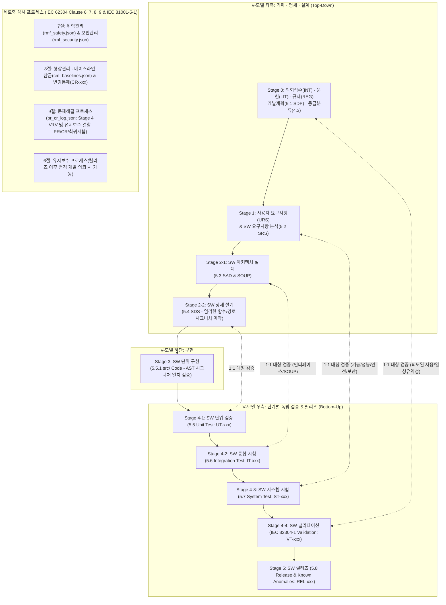

# 🏥 범용 의료기기 SW 멀티에이전트 프레임워크 마스터 설계 및 로드맵 (v3.2 Final)

본 문서는 **Antigravity**에 기반하여 사용자의 초기 개발 의뢰 접수부터 선행 문헌 연구, 동적 수행계획서(SDP) 수립, 그리고 **IEC 62304 전 조항(4절~9절)의 V-모델 생명주기 및 형상/변경/문제해결/위험관리 2차원 프로세스**를 수행하는 범용 의료기기 소프트웨어 개발 멀티에이전트 프레임워크의 최종 마스터 설계서입니다.

> [!IMPORTANT]
> **프레임워크 4대 절대 원칙 (3차 독립 감사 최종 확정)**
> 1. **문서 독점 소유권 (Strict Single Ownership) & 역인덱싱 추적성**:
>    * 각 파일은 오직 지정된 주인 에이전트만 수정(Write)할 수 있습니다 (`URS/SRS`는 `1-A`, `SAD/SOUP/SDS`는 `2-A`, `src/`는 `3-A`, `TC/tests/`는 `4-A`, `REL`은 `5-A`, `rmf_safety`는 안전위험 분석가, `rmf_security`는 보안위험 분석가, `audit_findings`는 감사관, `pr_cr_log`는 문제/변경 분석가).
>    * 위험·보안·감사·변경 에이전트는 절대 요구사항이나 설계서를 직접 건드리지 않으며, **그들의 출력 파일이 문서 주인(`1-A`, `2-A`, `3-A`, `4-A`)의 입력(Read)으로 들어가서 주인이 직접 수정**합니다.
>    * 소유권 침범 없이 양방향 추적성을 달성하기 위해, JSON 파일 내부에는 하위 항목이 상위 항목을 가리키는 `traces_to` 포인터만 기록하고, **상위$\rightarrow$하위 연결(예: `RC`가 어느 `SRS/SDS/TC`로 구현·검증되었는가)은 파이썬 엔진(`dhf_cli.py`/`gatekeeper.py`)이 자동 역인덱싱(Reverse Indexing)하여 계산·검증**합니다.
> 2. **블랙박스 단위/통합 시험(`UT/IT`)을 위한 설계 시그니처 계약 (Strict Interface Contract)**:
>    * 소스코드를 볼 수 없는 `4-A(블랙박스 테스터)`가 `ImportError`/`TypeError` 없이 단위(`UT`) 및 통합(`IT`) 테스트 코드를 작성할 수 있도록, `2-A(아키텍트)`는 `03_sad_soup.json`과 `04_sds.json`에 **정확한 대상 파일 경로(`target_file`), 함수/클래스 시그니처(`callable_signature`), 입출력 스키마 및 예외 클래스 계약**을 필수로 명시하며, Stage 3 검문소가 AST 파싱으로 코드와의 100% 일치를 강제합니다.
> 3. **개발 중 반복 수정(Iteration)과 공식 검증/릴리즈 후 변경관리(IEC 62304 6·8·9절)의 명확한 경계**:
>    * **구현 완료 전 (Stage 0 ~ Stage 3)**: 무거운 `PR/CR` 발행 없이, 피드백(`rmf_*`, `audit_findings`)을 입력받은 문서 주인이 즉시 버전을 올리고(`v+1`) `audit_history.jsonl`에 사유를 기록합니다. 상위 버전 변경에 따른 하위 재검토는 검문소의 **버전 불일치(`Suspect Link`) 검사**가 자동 통제합니다.
>    * **공식 V&V 진입 시점(Stage 4 Code Freeze) 이후 및 릴리즈(Stage 5) 후 유지보수(6절)**: 코드가 동결된 Stage 4 검증 중 발견되는 결함이나 릴리즈 후 변경 시에는 반드시 **`4-C(문제해결/변경분석가)`가 `pr_cr_log.json`에 문제보고서(`PR-xxx`, 9절)와 변경요청서/회귀시험 범위(`CR-xxx`, 8.2절/9.7절)를 발행**해야만 베이스라인 잠금이 열리고 수정 및 회귀 테스트가 수행됩니다.
> 4. **도구 자체 밸리데이션 (ISO 13485 4.1.6항, ISO/TR 80002-2 & FDA CSA)**: 모든 에이전트 산출물은 결정론적 파이썬 관리 도구(`dhf_cli.py`)와 자동 검문소(`gatekeeper.py`) 및 인간 승인(Human Sign-off)을 거치며, 해시 체인(`audit_history.jsonl`)으로 직접 수정 우회를 원천 차단합니다.

---

## 1. IEC 62304 V-모델 및 전 조항(Clause 4 ~ 9) 완벽 매핑 구조



---

## 2. 개발 대상 종류에 따른 동적 수행계획서(`00_sdp_plan.json`) 및 동적 입출력 바인딩

1. **의뢰 접수 인터뷰 (`0-0` 에이전트)**: 사용자의 초기 자유 의뢰에서 빠진 필수 정보(환자군, 임상 환경, 하드웨어 유무, AI 유무, 네트워크 연동 유무, 신규 개발 vs 기존 SW 유지보수 여부)를 질문하여 공식 개발 의뢰서(`00_intake.json`)를 확정합니다.
2. **표준 워크플로우 템플릿 기반 동적 입출력 구성 (`0-C` 에이전트)**:
   * 개발 대상의 안전등급(Class A/B/C)과 다중 옵션 스위치(AND 조합 가능)에 따라 `00_sdp_plan.json`의 `workflow_steps`가 구성될 때, **각 에이전트가 읽고 쓸 조건부 파일(`opt_*.json`) 목록이 동적으로 바인딩**됩니다:
     * **AI/ML 포함 (`ai_ml`)**: `opt_ai_spec.json` (`DAT-xxx` 데이터셋 품질, 학습 재현성, PCCP 경계) 활성화.
     * **하드웨어 내장/알람 포함 (`SiMD` / `alarm_system`)**: `opt_simd_alarm.json` (`HSI-xxx` 하드웨어-SW 인터페이스, `ALM-xxx` IEC 60601-1-8 알람 규격) 활성화.
     * **GUI 중심 기기 (`gui_usability_adv`)**: `opt_usability_gui.json` (`UE-xxx` 사용오류 시나리오, 형성/총괄평가 프로토콜) 활성화.
     * *(여러 옵션이 동시에 켜지면 `1-E`가 활성화된 모든 `opt_*.json` 파일을 생성하며, Stage 1~5의 모든 관련 에이전트 Read 목록에 동시 주입됩니다.)*

---

## 3. 전 에이전트별 [역할 · 입력(Read) · 출력(Write 독점) · 동작 방식] 상세 명세표

### 3.1 총괄 지휘 · Stage 0 (기획 및 수행계획 수립)

| 에이전트 | 핵심 역할 | 📖 입력 (Read-Only) | ✍️ 출력 (Write - 독점) | ⚙️ 구체적 동작 방식 |
| :--- | :--- | :--- | :--- | :--- |
| **👑 0. 공장장**<br>(Orchestrator) | 워크플로우 실행 지휘 및 상태 전이 관리 | • `00_sdp_plan.json`<br>• `audit_findings.json`<br>• `pr_cr_log.json`<br>• 자동 검문소 결과 | • `00_sdp_plan.json` *(진행 상태 `status` 갱신)*<br>• `cm_baselines.json` *(베이스라인 스냅샷 및 잠금 기록)* | • 직접 문서를 쓰거나 코딩하지 않음.<br>• `00_sdp_plan.json`에 정의된 순서와 동적 입출력 목록에 따라 에이전트를 호출함.<br>• 위험/보안/감사/문제보고(`PR/CR`) 출력 발생 시, 해당 문서를 소유한 작성 에이전트(`1-A`, `2-A`, `3-A`, `4-A`)에게 그 출력 파일을 입력으로 넣어 수정하도록 루프를 돌림. |
| **0-0. 의뢰 접수자**<br>(Intake Agent) | 개발 의뢰 접수 및 필수 정보 인터뷰 | • 사용자의 초기 자유 의뢰<br>• (`0-D` 반려 시) `audit_findings.json` | • **`00_intake.json`** (`INT-xxx`: 의도된 사용, 적응증, 환자군, 환경, 신규/유지보수 구분) | • 초기 의뢰에서 부족한 정보를 사용자에게 질문하여 확인받은 뒤, 모든 개발의 출발점이 되는 `00_intake.json`을 생성함. |
| **0-A. 문헌 연구원**<br>(Literature Researcher) | 관련 임상·공학 기술 문헌 조사 | • `00_intake.json`<br>• `audit_findings.json` | • **`00_literature.json`** (`LIT-xxx`: 표준 알고리즘, 임상 성능 기준, 유사 기기 부작용 사례) | • `00_intake.json`의 의도된 사용(`INT-xxx`)을 바탕으로 기술적 근거와 최신 기술 수준(State of the Art) 문헌을 조사해 기록함. |
| **0-B. 규제 전략가**<br>(Regulatory Strategist) | 안전등급 분류(4.3절) 및 적용 표준 도출 | • `00_intake.json`<br>• `00_literature.json`<br>• `audit_findings.json` | • **`00_regulatory.json`** (`REG-xxx`: Class A/B/C, FDA Basic/Enhanced, 적용 표준 목록) | • 의도된 사용과 문헌 근거를 분석해 기기 유형(SaMD/SiMD), 안전등급, 필수 및 선택 표준(보안, AI, 알람, 품목별 규격 등)을 도출함. |
| **0-C. 수행계획 수립가**<br>(SDP Planner) | 개발계획서(5.1절) 및 동적 워크플로우/입출력 편성 | • `00_intake.json`<br>• `00_literature.json`<br>• `00_regulatory.json`<br>• `audit_findings.json` | • **`00_sdp_plan.json`** (`SDP-xxx` 계획 + 표준 템플릿 기반 `workflow_steps` 및 **동적 입출력 목록**) | • 개발 언어/도구, 위험 평가 매트릭스 기준, 형상/변경관리 계획(8절), 검증 합격 기준을 정의함.<br>• 개발 대상 특성에 맞춰 실행할 에이전트들과 **각 에이전트가 읽고 쓸 파일 목록(활성화된 모든 `opt_*.json` 포함)**을 바인딩함. |
| **0-D. Stage 0 감사관**<br>(Stage 0 Auditor) | 기획 및 개발계획(5.1절) 감사 | • `00_intake.json`, `00_literature.json`, `00_regulatory.json`, `00_sdp_plan.json` | • **`audit_findings.json`** (`AUD-xxx`: `PASS` 또는 `REJECT`) | • 의도된 사용 대비 안전등급이 타당한지, 수행계획서의 워크플로우와 동적 입출력 배정에 누락이 없는지 심사함. |

### 3.2 Stage 1: SW 요구사항 분석 단계 (IEC 62304 5.2절 & 7.1절)

| 에이전트 | 핵심 역할 | 📖 입력 (Read-Only) | ✍️ 출력 (Write - 독점) | ⚙️ 구체적 동작 방식 |
| :--- | :--- | :--- | :--- | :--- |
| **1-A. 요구사항 작성자**<br>(Requirements Author) | 사용자 요구사항(`URS`) 및 SW 요구사항(`SRS`, 5.2절) 전담 작성/수정 | **[초안 작성 시]**<br>• Stage 0 전체 JSON<br>**[피드백/변경 반영 시 추가 입력]**<br>• **`rmf_safety.json`**<br>• **`rmf_security.json`**<br>• **`audit_findings.json`**<br>• *(Stage 4/유지보수 변경 시)* **`pr_cr_log.json`**<br>• *(동적)* 활성화된 모든 `opt_*.json` | • **`01_urs.json`** (`URS-xxx`)<br>• **`02_srs.json`** (`SRS-xxx`)<br>*(⚠️ 오직 1-A만 요구사항 파일 수정 가능!)* | • **1차 동작(초안)**: Stage 0 문서를 입력받아 기능/성능/인터페이스 요구사항 초안(v1)을 작성함.<br>• **2차 동작(피드백 반영)**: 위험(`1-B`), 보안(`1-C`), 옵션(`1-E`), 감사(`1-D`), 또는 Stage 2(`2-B`/`2-C`)가 출력한 파일을 **입력으로 읽어서** 안전/보안/옵션/파생 요구사항을 `02_srs.json`(v+1)에 직접 반영하고 `traces_to: {"RC-xxx": ver}` 포인터를 연결함. |
| **1-B. 임상·사용오류 위험 분석가**<br>(Safety & Usability Risk) | 초기 안전 위해요인(PHA) 및 사용오류 분석 | • Stage 0 JSON, `01_urs.json`, **`02_srs.json`**<br>• **`rmf_security.json`** *(안전-보안 충돌 확인)*<br>• *(동적)* `opt_*.json`, `audit_findings.json` | • **`rmf_safety.json`** (`HAZ-SAF-xxx`, `RC-SAF-xxx`: 초기 위험도 및 안전 통제 대책) | • 요구사항 초안을 읽고 임상 위험 및 사용오류를 도출해 `rmf_safety.json`에만 기록함. **(절대 `02_srs.json`을 직접 손대지 않음!)**<br>• `1-C` 작업 후 보안 대책이 임상 안전을 해치지 않는지 교차 검토함. |
| **1-C. 초기 보안 위험 분석가**<br>(Security Risk Analyst) | 초기 사이버보안 위협 및 보안 통제 도출 | • Stage 0 JSON, `01_urs.json`, **`02_srs.json`**<br>• `rmf_safety.json`, `audit_findings.json` (`+ opt_*.json`) | • **`rmf_security.json`** (`HAZ-SEC-xxx`, `RC-SEC-xxx`: 보안 위협 및 보안 통제 대책) | • 요구사항 초안을 읽고 데이터 보호·인증·접근제어·감사로그 등 필요한 보안 대책을 `rmf_security.json`에만 출력함 ($\rightarrow$ `1-A`의 입력으로 전달됨). |
| *(동적 조건부)*<br>**1-E. 옵션 도메인 명세가**<br>(AI / SiMD·알람 / GUI) | 수행계획서에 활성화된 특화 도메인 명세 작성 (다중 AND 지원) | • `00_sdp_plan.json`, `01_urs.json`, `02_srs.json`<br>• `rmf_safety.json`, `rmf_security.json`, `audit_findings.json` | • 활성화된 모든 옵션 파일 독점 출력:<br>  - **`opt_ai_spec.json`** (`DAT-xxx`)<br>  - **`opt_simd_alarm.json`** (`HSI/ALM-xxx`)<br>  - **`opt_usability_gui.json`** (`UE-xxx`) | • `00_sdp_plan.json`에서 켜진 모든 옵션 도메인 명세를 각각의 `opt_*.json` 파일에 출력함 ($\rightarrow$ `1-A`, `1-B`, `1-C` 및 후속 Stage의 입력으로 전달됨). |
| **1-D. Stage 1 감사관**<br>(Stage 1 Auditor) | 요구사항 검증(5.2.6절) 및 초기 위험/보안 감사 | • Stage 0~1 전체 JSON 파일 (`+ opt_*.json`) | • **`audit_findings.json`** (`AUD-xxx`) | • 모든 위험/보안 대책(`RC`)과 옵션 명세가 `1-A`에 의해 `02_srs.json`에 반영되었는지, 모호성 없이 테스트 가능한지 심사하여 기록함. |

### 3.3 Stage 2: SW 아키텍처 설계(5.3절) 및 상세 설계(5.4절) 단계

| 에이전트 | 핵심 역할 | 📖 입력 (Read-Only) | ✍️ 출력 (Write - 독점) | ⚙️ 구체적 동작 방식 |
| :--- | :--- | :--- | :--- | :--- |
| **2-A. 소프트웨어 아키텍트**<br>(Software Architect) | 아키텍처(`SAD`, 5.3절), `SOUP`(5.3.3절), 상세설계(`SDS`, 5.4절) 전담 작성/수정 | **[초안 설계 시]**<br>• `00_sdp_plan.json`, `02_srs.json`, `rmf_safety.json`, `rmf_security.json` (`+ opt_*.json`)<br>**[피드백/변경 반영 시 추가 입력]**<br>• `2-B`/`2-C`가 갱신한 **`rmf_safety.json`**, **`rmf_security.json`**<br>• **`audit_findings.json`**, *(Stage 4/유지보수 시)* **`pr_cr_log.json`** | • **`03_sad_soup.json`** (`SAD-xxx`, `SOUP-xxx` - 모듈별 안전등급 분리 포함)<br>• **`04_sds.json`** (`SDS-xxx` - **엄격한 파일 경로·함수 시그니처·입출력/예외 계약 필수!**)<br>*(⚠️ 오직 2-A만 설계 파일 수정 가능!)* | • **1차 동작(초안)**: 아키텍처 모듈/인터페이스(`SAD`), 외부 라이브러리(`SOUP`), 그리고 블랙박스 `UT/IT`가 즉시 호출 가능한 **엄격한 함수 시그니처 계약이 포함된 상세설계(`SDS`)** 초안 작성.<br>• **2차 동작(피드백 반영)**: `2-B(DFMEA)`, `2-C(보안)`, `2-D(감사)`의 출력을 **입력으로 읽어서** 설계서를 직접 보완함. |
| **2-B. 설계 결함 위험 분석가**<br>(DFMEA Risk Analyst) | 아키텍처·상세설계·SOUP 결함 안전 위험 분석(7.1/7.2절) | • `00_sdp_plan.json`, `02_srs.json`<br>• **`03_sad_soup.json`**, **`04_sds.json`**<br>• `rmf_*.json` (`+ opt_*.json`) | • **`rmf_safety.json`** (설계 단계 신규 `HAZ-SAF-xxx`, `RC-SAF-xxx`) | • 모듈 장애, 통신 단절, `SOUP` 오작동 위험을 분석해 `rmf_safety.json`에만 출력함. **(설계서나 요구사항 직접 수정 절대 금지!)**<br>• 신규 `RC`가 파생 요구사항을 필요로 하면 공장장이 `rmf_safety.json`을 `1-A`(`SRS` 추가) $\rightarrow$ `2-A`(`SDS` 수정) 순서로 입력에 넣어 반영시킴. |
| **2-C. 위협 모델러 & SOUP 보안 분석가**<br>(Threat & SOUP Security) | 아키텍처 위협 모델링(STRIDE) 및 SOUP CVE 분석 | • `00_sdp_plan.json`, `02_srs.json`<br>• **`03_sad_soup.json`**, **`04_sds.json`**<br>• `rmf_*.json` (`+ opt_*.json`) | • **`rmf_security.json`** (설계/SOUP 보안 `HAZ-SEC-xxx`, `RC-SEC-xxx`) | • 데이터 흐름 위협과 `SOUP` 보안 취약점을 분석해 `rmf_security.json`에만 출력함 ($\rightarrow$ `1-A` 및 `2-A`의 입력으로 전달되어 반영됨). |
| **2-D. Stage 2 감사관**<br>(Stage 2 Auditor) | 아키텍처 검증(5.3.6절) 및 상세설계 검증(5.4.4절) 감사 | • Stage 0~2 전체 JSON 파일 (`+ opt_*.json`) | • **`audit_findings.json`** (`AUD-xxx`) | • `SRS` $\leftrightarrow$ `SAD` $\leftrightarrow$ `SDS` 추적성, 안전 등급별 격리(Segregation), `04_sds.json`의 함수 시그니처 계약 완결성을 심사함. |

### 3.4 Stage 3: SW 단위 구현 단계 (IEC 62304 5.5.1절)

| 에이전트 | 핵심 역할 | 📖 입력 (Read-Only) | ✍️ 출력 (Write - 독점) | ⚙️ 구체적 동작 방식 |
| :--- | :--- | :--- | :--- | :--- |
| **3-A. 구현 개발자**<br>(Developer) | 상세설계(`SDS`) 시그니처 계약 기반 소스코드 전담 구현 및 수정 | **[초안 구현 시]**<br>• `00_sdp_plan.json`, `03_sad_soup.json`, `04_sds.json` (`+ opt_*.json`)<br>**[피드백/버그 수정 시 추가 입력]**<br>• **`rmf_safety.json`**, **`rmf_security.json`**<br>• **`audit_findings.json`**, *(Stage 4/유지보수 시)* **`pr_cr_log.json`** | • **`src/` 소스코드 파일들**<br>(`# @traces: SDS-xxx@ver` 필수)<br>*(⚠️ 오직 3-A만 소스코드 수정 가능!)* | • 승인된 `04_sds.json`에 정의된 정확한 파일 경로·함수 시그니처·예외 계약을 100% 준수하여 코드를 구현함.<br>• `3-B`, `3-C`, 또는 Stage 4 문제보고(`PR/CR`)를 **입력으로 받아** 소스코드를 직접 수정함. |
| **3-B. 코드 안전·시큐어코딩 분석가**<br>(Code Safety & SAST) | 구현 코드 정적분석(SAST) 및 아키텍처 파생 위험 분석 | • `00_sdp_plan.json`, `04_sds.json`, **`src/` 소스코드**, `rmf_*.json` (`+ opt_*.json`) | • **`rmf_safety.json`**, **`rmf_security.json`** *(신규 설계/구현 수준 위험 발견 시)* | • 구현으로 인해 새롭게 유발된 안전/보안 위험(ISO 14971 / IEC 81001-5-1)을 위험 파일에 기록함.<br>• *(단순 코딩 실수나 명세 미준수 버그는 `rmf_*.json`에 `HAZ`로 등록하지 않고 `3-C` 감사관 및 검문소가 `audit_findings.json`을 통해 `3-A`에게 즉시 수정 지시)* |
| **3-C. Stage 3 감사관**<br>(Stage 3 Auditor) | 단위 구현 규칙(5.5.2~5.5.4절) 및 시큐어코딩 결함 감사 | • Stage 2~3 전체 파일 (`03_sad_soup`, `04_sds`, `rmf_*`, `src/`, `+ opt_*.json`) | • **`audit_findings.json`** (`AUD-xxx`) | • `04_sds.json` 시그니처 계약 일치 여부, 시큐어코딩/정적분석 결함 해결 여부, 미승인 `SOUP` 무단 `import` 여부를 심사함. |

### 3.5 Stage 4 ~ 5: V-모델 4계층 독립 검증(5.5 ~ 5.7절, 밸리데이션) · 문제해결(9절) · 릴리즈(5.8절)

| 에이전트 | 핵심 역할 | 📖 입력 (Read-Only) | ✍️ 출력 (Write - 독점) | ⚙️ 구체적 동작 방식 |
| :--- | :--- | :--- | :--- | :--- |
| **4-A. 독립 블랙박스 테스트 개발자**<br>(Black-box V&V Tester) | V-모델 4계층 테스트 명세(`05_tc.json`) 및 테스트 코드 전담 작성 | • `00_intake.json`, `00_sdp_plan.json`<br>• `01_urs.json` ($\rightarrow$ `VT` 작성용)<br>• `02_srs.json`, `rmf_*.json` ($\rightarrow$ `ST` 및 고장유도 테스트 작성용)<br>• `03_sad_soup.json` ($\rightarrow$ `IT` 통합시험 작성용)<br>• `04_sds.json` ($\rightarrow$ 시그니처 계약 기반 `UT` 단위검증 작성용)<br>• (`+ opt_*.json`), `audit_findings.json`, `pr_cr_log.json`<br>*(🚫 **`src/` 소스코드는 절대 열람 불가!**)* | • **`05_tc.json`**<br>(`UT-xxx` 단위검증, `IT-xxx` 통합시험, `ST-xxx` 시스템시험, `VT-xxx` 밸리데이션)<br>• **`tests/` 테스트 코드**<br>(`# @verifies: ...`) | • 소스코드를 보지 않고 `04_sds.json`의 정확한 함수 시그니처 계약과 상위 명세서를 기반으로 4계층 테스트(`UT` $\rightarrow$ `IT` $\rightarrow$ `ST` $\rightarrow$ `VT`) 및 위험통제 고장유도(Negative) 테스트를 작성함.<br>• `dhf_cli.py run-tests --redact-src`로 테스트를 실행함. |
| **4-B. 잔여위험 최종 평가가**<br>(Residual Risk Evaluator — **ISO 14971 7.4절 & 8절**) | 검증 결과 기반 안전/보안 잔여위험 최종 마감 | • `00_intake.json`, `00_literature.json`<br>• `rmf_safety.json`, `rmf_security.json`<br>• `05_tc.json` 및 **테스트 실행 통과 리포트** | • **`rmf_safety.json`** *(잔여위험 최종 평가 및 유익성-위험 결론 갱신)*<br>• **`rmf_security.json`** *(보안 잔여위험 최종 판정 갱신)* | • 모든 안전/보안 통제 조치(`RC`)가 실제 테스트(`UT/IT/ST/VT`)를 통과했는지 확인하고, 남은 잔여위험이 임상적 유익성(`INT-xxx`) 대비 허용 가능한지 `rmf_*.json`을 최종 마감함. |
| **4-C. 문제해결 및 변경영향 분석가**<br>(Problem & Change Analyst — **IEC 62304 8.2절 & 9절 전담**) | Stage 4 공식 검증 결함 또는 유지보수(6절) 시 `PR/CR` 발행 | • 테스트 실패 로그, `audit_findings.json`<br>• `01_urs.json` ~ `05_tc.json`, `rmf_*.json`, `src/` | • **`pr_cr_log.json`**<br>(`PR-xxx` 문제보고서, 원인/안전영향 분석, `CR-xxx` 변경요청서 및 수정 대상/회귀테스트 범위 지정) | • Stage 4 검증 실패 또는 릴리즈 후 유지보수 변경 시 `PR-xxx`(9.1절)를 생성하고, 누구의 수정 대상(`1-A`, `2-A`, `3-A`, `4-A`)인지 조사(9.2절)함.<br>• 수정 시 영향을 받는 모듈과 **회귀 테스트(Regression Test, 9.7절) 대상 목록**을 계산해 `CR-xxx`(8.2절)를 출력함 ($\rightarrow$ 해당 문서 주인의 입력으로 전달됨). |
| **5-A. SW 릴리즈 작성자**<br>(Release Author — **IEC 62304 5.8절 전담**) | 릴리즈 문서(`06_release.json`) 및 잔여 결함 명세 전담 작성 | • 전체 JSON 파일 (`rmf_*.json` 최종 마감본 포함) + 테스트/회귀테스트 통과 리포트 + `pr_cr_log.json` | • **`06_release.json`** (`REL-xxx`: 릴리즈 버전, 알려진 잔여 결함 Known Anomalies 및 안전성 정당화, 빌드 환경 아카이브)<br>*(⚠️ 오직 06_release.json만 독점 수정!)* | • 마감된 `rmf_*.json`과 `pr_cr_log.json`을 읽고, 보류된 경미 결함(`DEFERRED` 상태의 Known Anomalies)의 안전성 정당화 및 최종 형상 베이스라인을 정리해 `06_release.json`을 출력함. |
| **5-B. 최종 릴리즈 감사관**<br>(Final Release Auditor) | 전 주기 V-모델 추적성(RTM), 형상관리(8절), 문제해결(9절) 최종 감사 | • `store/` 내 전체 파일 + `audit_history.jsonl` + 테스트 리포트 | • **`audit_findings.json`** (최종 릴리즈 승인 권고서) | • V-모델 양방향 100% 커버리지, 모든 `PR/CR`이 `CLOSED` 되었거나 `DEFERRED`(잔여 결함)인 경우 안전성 정당화 후 `06_release.json`에 등재되었는지, 그리고 베이스라인 해시 무결성을 최종 감사함. |

---

## 4. 데이터 저장소(`store/`) 전체 파일 구조 (Step 1 스키마)

```text
📁 project_root/
 ├── 📁 store/                        # [원본 데이터 저장소 - 오직 dhf_cli.py를 통해서만 수정 가능]
 │    ├── 🔒 .dhf.lock                # 동시성 제어용 OS 파일 잠금 (fcntl.flock)
 │    ├── 📄 00_intake.json           # [0-0 독점] 개발 의뢰서 및 의도된 사용 (INT-xxx)
 │    ├── 📄 00_literature.json       # [0-A 독점] 기술·임상 문헌 연구 (LIT-xxx)
 │    ├── 📄 00_regulatory.json       # [0-B 독점] 안전등급(4.3절) 및 규제/표준 요건 (REG-xxx)
 │    ├── 📄 00_sdp_plan.json         # [0-C / 공장장] 개발계획서(5.1절, SDP-xxx) + 동적 워크플로우 & 입출력 바인딩
 │    ├── 📄 01_urs.json              # [1-A 독점] 사용자 요구사항 (URS-xxx)
 │    ├── 📄 02_srs.json              # [1-A 독점] SW 요구사항 명세 (5.2절, SRS-xxx)
 │    ├── 📄 03_sad_soup.json         # [2-A 독점] SW 아키텍처(5.3절, SAD-xxx) 및 외부 라이브러리(SOUP-xxx)
 │    ├── 📄 04_sds.json              # [2-A 독점] SW 상세설계 (5.4절, SDS-xxx - 엄격한 함수/경로 시그니처 계약 포함)
 │    ├── 📄 05_tc.json               # [4-A 독점] V-모델 4계층 시험 명세 (UT-xxx, IT-xxx, ST-xxx, VT-xxx)
 │    ├── 📄 06_release.json          # [5-A 독점] SW 릴리즈 및 알려진 잔여 결함 명세 (5.8절, REL-xxx)
 │    ├── 📄 rmf_safety.json          # [1-B/2-B/3-B/4-B 독점] 전 주기 안전/사용오류 위험관리 (7절, HAZ-SAF-xxx, RC-SAF-xxx)
 │    ├── 📄 rmf_security.json        # [1-C/2-C/3-B/4-B 독점] 전 주기 사이버보안 위험관리 (HAZ-SEC-xxx, RC-SEC-xxx)
 │    ├── 📄 audit_findings.json      # [감사관 독점] 단계별 독립 품질 감사 지적사항 및 판정 (AUD-xxx)
 │    ├── 📄 pr_cr_log.json           # [4-C 독점] 문제해결 보고서(9절, PR-xxx) 및 변경통제/영향성분석(8.2절, CR-xxx)
 │    ├── 📄 cm_baselines.json        # [공장장/엔진 독점] 형상관리 베이스라인 스냅샷 및 잠금 상태 (8.1/8.3절, BL-xxx)
 │    ├── 📄 opt_ai_spec.json         # [조건부 1-E 독점] AI/ML 데이터·모델·PCCP 명세 (DAT-xxx)
 │    ├── 📄 opt_simd_alarm.json      # [조건부 1-E 독점] 하드웨어 인터페이스(HSI-xxx) 및 알람(ALM-xxx) 명세
 │    ├── 📄 opt_usability_gui.json   # [조건부 1-E 독점] GUI 사용적합성 평가 프로토콜 명세 (UE-xxx)
 │    └── 📜 audit_history.jsonl      # [엔진 자동 기록] 6하원칙 + 해시 체인(prev_hash, state_hash) 전 버전 이력장
 ├── 📁 src/                          # [3-A 독점] 구현 소스코드 (# @traces: SDS-001@1)
 ├── 📁 tests/                        # [4-A 독점] 단위/통합/시스템/밸리데이션 테스트 코드 (# @verifies: ...)
 └── 📁 docs/                         # [자동 생성] store/로부터 역인덱싱을 통해 1초 만에 출력되는 인허가 합본 Markdown 문서들
```

---

## 5. 프레임워크 구축 5단계 로드맵

| 단계 | 목표 | 핵심 산출물 및 검증 내용 |
| :--- | :--- | :--- |
| **Step 1** | **데이터 저장소 및 번호표 상세 스키마 확정** | 위 `store/` 파일들의 JSON 필드 규격(`04_sds.json` 함수 시그니처 계약 포함) 및 V-모델 추적성 연결 규칙 확정 |
| **Step 2** | **파이썬 DHF 관리 엔진 & 자동 검문소 구현 (+ 자체 밸리데이션)** | `dhf_cli.py` (독점 소유권 권한 검사·역인덱싱·해시체인·마크다운 생성) + `gatekeeper.py` (V-모델 양방향 추적성·AST 시그니처 일치·버전·빈코드·SOUP 검사) + **ISO/TR 80002-2 자가 검증 테스트(`test_framework_csa.py`)** |
| **Step 3** | **Stage 0 ~ Stage 2 시운전 (의뢰접수 $\rightarrow$ 수행계획 $\rightarrow$ 요구사항 $\rightarrow$ 설계)** | 샘플 의료기기 의뢰로 `0-0` 인터뷰부터 `1-A`/`2-A`의 위험·보안·감사 피드백 입력 반영 루프 검증 |
| **Step 4** | **Stage 3 ~ Stage 5 연결 (구현 $\rightarrow$ V-모델 4계층 검증 $\rightarrow$ PR/CR 변경관리 $\rightarrow$ 릴리즈)** | AST 시그니처 검사, 블랙박스 테스트(`UT/IT/ST/VT`), 결함 발생 시 `4-C`의 `PR/CR` 발행 및 회귀 테스트 루프, 최종 릴리즈 검증 |
| **Step 5** | **Antigravity 범용 패키지(`.agents/`) 모듈화** | 어떤 프로젝트에든 이식 가능한 `Rules`, `Skills`, `Hooks` 패키징 완성 |
