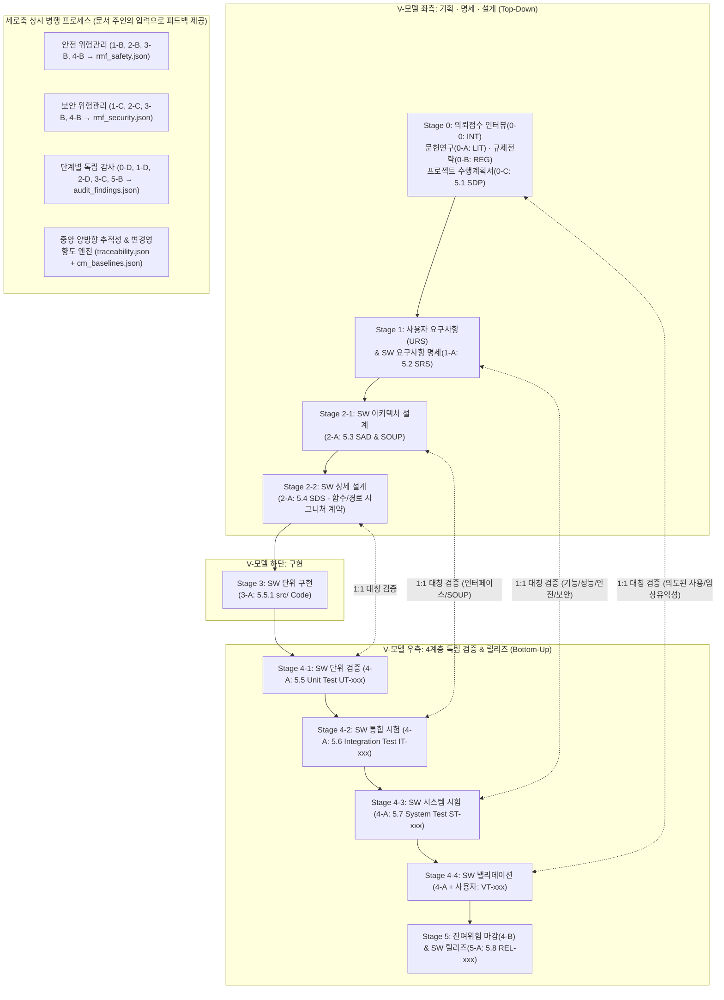

# 🏥 SaMD / 의료기기 SW 개발 멀티에이전트 프레임워크 마스터 로드맵

## 1. 프로젝트 목표 및 핵심 철학
- 특정 단일 소프트웨어가 아닌, **임의의 의료기기 소프트웨어(SaMD 및 필요 시 임베디드 SiMD)** 개발에 범용으로 사용할 수 있는 **Antigravity 기반 멀티에이전트 프레임워크** 구축
- 사용자의 초기 의뢰 접수(대화형 인터뷰)부터 선행 문헌/규제 조사, **맞춤형 프로젝트 수행계획서(SDP) 수립**, 그리고 **IEC 62304 V-모델 기반 명세화(URS/SRS/SAD/SOUP/SDS) $\rightarrow$ 구현 $\rightarrow$ 4계층 독립 검증(UT/IT/ST/VT) $\rightarrow$ 릴리즈**에 이르는 메인 파이프라인과, 전 주기에 걸쳐 작동하는 **위험관리·사이버보안·형상관리·변경관리·독립감사**의 2차원(2D) 프로세스를 체계적으로 오케스트레이션함.
- **품질시스템용 SW 자체 밸리데이션 (ISO 13485 4.1.6항, ISO/TR 80002-2 & FDA CSA 준수)**:
  - 본 프레임워크는 의료기기 품질경영시스템(QMS)에서 설계·개발·검증·문서화에 사용되는 비제품 소프트웨어(QMS Tool)임.
  - 비결정론적 AI 에이전트가 작성한 결과물은 항상 **'초안(Draft)'**으로 취급하며, 모든 데이터 저장과 검증은 **결정론적 파이썬 관리 도구(`dhf_cli.py`)와 자동 검문소(`gatekeeper.py`)** 및 단계별 **인간 승인(Human Sign-off)**을 거침.
  - 프레임워크 자체의 요구사항(`TOOL-REQ`), 도구 위험분석, 검문소 자가 검증 테스트(`test_framework_csa.py`)를 내장하여 심사관에게 **도구 밸리데이션 보고서(CSA Report)**를 즉시 제시할 수 있도록 구축함.

---

## 2. 적용 표준 체계 (코어 + 프로필 스위치 + 교차 위험 매트릭스)

프로젝트 초기(Stage 0)에 개발 의뢰 특성을 분석하여 아래 3계층 표준을 맞춤형으로 조합합니다.

### 2.1 절대 코어 표준 (모든 프로젝트 공통 필수)
| 표준 / 가이드라인 | 역할 및 프레임워크 내 적용 방식 |
| :--- | :--- |
| **IEC 62304** (1판 Amd1 & 2판 대비) | SW 생명주기 프로세스 (4절~9절 전 조항 및 Class A / B / C 등급별 필수 산출물·엄격도 차등화) |
| **ISO 14971 & ISO 24971** | 전 주기 안전 위험관리 (초기위험 $S_1 \times P_1$ $\rightarrow$ 통제 우선순위 1>2>3순위 강제 $\rightarrow$ 검증 연결 $\rightarrow$ 잔여위험 $S_2 \times P_2$ 및 임상 유익성 대비 평가) |
| **ISO 13485 (4.1.6절, 7.3절)** | 품질경영시스템 설계·개발 관리, 양방향 추적성(RTM), 개발 도구 밸리데이션 |
| **IEC 62366-1** | 기본 사용적합성 엔지니어링 (모든 UI/알람/API/매뉴얼에서의 사용 오류 Use Error 식별 및 통제) |
| **IEC 81001-5-1 & FDA OTS** | 기본 보안 생명주기, 시큐어 코딩, **SOUP/OTS(외부 오픈소스 라이브러리) 무단 추가 차단 및 검증** |
| **ISO/TR 80002-2 & FDA CSA** | 프레임워크 자체의 결정론적 Gate 검증 및 해시 체인 기반 감사 추적(Audit Trail) |
| **IMDRF N41 & ISO 20416** | 의도된 사용(`INT`) $\leftrightarrow$ 임상평가(Clinical Evaluation) 및 시판 후 감시(PMS) 연계 |

### 2.2 기기 유형 분기 및 기능 옵션 스위치 (`00_sdp_plan.json` 내 프로필 설정)
- **기기 형태 (택1)**:
  - `SaMD` (단독 소프트웨어) $\rightarrow$ **IEC 82304-1** (건강 SW 시스템 요구사항 및 제품 Validation)
  - `SiMD` (하드웨어 내장 임베디드) $\rightarrow$ **IEC 60601-1 (Clause 14 PEMS)** (하드웨어-SW 인터페이스 및 전기/기계적 페일세이프)
- **인허가 타겟 국가 (다중 선택)**: `MFDS`(식약처), `FDA`(2023 Basic/Enhanced 문서 수준), `CE_MDR`
- **기능 옵션 스위치 (다중 AND 조합 가능)**:
  - `cybersecurity_adv`: **ANSI/AAMI SW96**, FDA/식약처 보안 가이드 (STRIDE 위협 모델링, CVE 취약점 분석, 암호화/감사로그/침투테스트)
  - `ai_ml`: **BS/AAMI 34971 (ISO/TS 24971-2)**, **GMLP**, **ISO/IEC 5259**(데이터 품질), **ISO/IEC 42001**, **FDA PCCP**(사전변경관리계획), **EU AI Act**
  - `gui_usability_adv`: **IEC 62366-1 심화** (와이어프레임/프로토타입 기반 형성평가 Formative 및 총괄평가 Summative 프로토콜)
  - `alarm_system`: **IEC 60601-1-8** (의료용 알람 우선순위 고/중/저, 시각·청각 신호 규격, 일시정지 안전 조건)
  - `interoperability`: **HL7 FHIR / DICOM**, **HIPAA / GDPR / 개인정보보호법** (비식별화/가명화 검증)
  - **품목별 특화 표준**: Stage 0 문헌/규제 조사에서 기기 품목에 맞춰 동적 도출 (예: 심전도 AAMI EC57 등)

### 2.3 옵션 간 교차 위험 매트릭스 (Cross-cutting Rules)
- **`[ai_ml]` $\times$ `[cybersecurity_adv]` (AAMI CR515)**: 학습 데이터 중독(Data Poisoning), 적대적 공격(Adversarial Attack), 모델 추출 방어 요구사항 강제
- **`[ai_ml]` $\times$ `[IEC 62366-1 사용적합성]`**: 의료진의 자동화 편향(Automation Bias) 방지를 위한 신뢰도(Confidence Score), 판단 근거(XAI), 입력 데이터 분포 이탈(OOD) 경고 표시 강제
- **`[ISO 14971 안전]` $\times$ `[IEC 81001-5-1 보안]`**: 보안 통제(세션 잠금, 다중 인증, 암호화 지연)가 응급 임상 상황에서 환자 안전을 저해하지 않는지 **Safety vs. Security 상충 교차 검토** 의무화

---

## 3. 프레임워크 5대 핵심 설계 원칙

### 원칙 1: 프로젝트 수행계획서(`00_sdp_plan.json`) = 공장장 에이전트의 실행 대본 & 동적 입출력 바인딩
- 개발 의뢰가 들어오면 `Stage 0`에서 의뢰 특성을 분석하여 **이번 프로젝트의 맞춤형 작업 순서(`workflow_steps`)와 에이전트별 동적 입출력 파일 목록(`opt_*.json` 포함), 코딩/위험/테스트 합격 기준**을 담은 **프로젝트 수행계획서(`00_sdp_plan.json`)**를 작성합니다.
- **총괄 공장장(Orchestrator) 에이전트는 이 `00_sdp_plan.json`을 입력(작업 지시서 겸 상태 머신)으로 삼아** 이후 모든 작업을 순서대로 지휘합니다. (단, 에이전트가 필수 단계를 임의로 빼먹지 못하도록 사전 검증된 **표준 워크플로우 템플릿 DAG**에서 조건부 단계를 활성화하는 방식을 사용합니다.)

### 원칙 2: 절대 문서 독점 소유권 (Single Ownership) & 피드백 입력 루프
- **어떤 에이전트도 남의 문서를 직접 수정(Write)할 수 없습니다**:
  - 요구사항(`01_urs.json`, `02_srs.json`)은 **오직 `1-A(요구사항 작성자)`만** 수정 가능
  - 설계서(`03_sad_soup.json`, `04_sds.json`)는 **오직 `2-A(아키텍트)`만** 수정 가능
  - 소스코드(`src/`)는 **오직 `3-A(구현 개발자)`만** 수정 가능
  - 테스트(`05_tc.json`, `tests/`)는 **오직 `4-A(블랙박스 테스터)`만** 수정 가능
  - 릴리즈(`06_release.json`)는 **오직 `5-A(릴리즈 작성자)`만** 수정 가능
- **위험·보안·감사의 출력 $\rightarrow$ 작성자의 입력으로 순환**:
  - 안전위험 에이전트는 **`rmf_safety.json`만**, 보안위험 에이전트는 **`rmf_security.json`만**, 감사관 에이전트는 **`audit_findings.json`만** 출력합니다.
  - **이 출력 파일들이 다시 문서 주인(`1-A`, `2-A`, `3-A`, `4-A`)의 '입력(Read-Only)'으로 들어가서**, 문서 주인이 직접 자기 문서를 수정(버전 `v+1`)합니다.

### 원칙 3: 별도의 중앙 양방향 추적성 장부(`traceability.json`) 이중 관리
- 개별 문서(`02_srs.json`, `04_sds.json`, 코드 주석) 안에만 연결고리(`traces_to`)를 흩어놓으면 에이전트의 실수로 연결이 유실될 위험이 있습니다.
- 따라서 파이썬 관리 도구(`dhf_cli.py`)가 항목을 등록·수정할 때마다 **별도의 중앙 추적성 전용 장부인 `traceability.json`에 `[상위 ID@버전 <-> 하위 ID@버전]` 양방향 매핑을 명시적으로 기록·관리**하며, 자동 검문소(`gatekeeper.py`)가 개별 문서와 `traceability.json` 간의 정합성 및 위$\rightarrow$아래 / 아래$\rightarrow$위 100% 커버리지를 교차 검증합니다.

### 원칙 4: 실용적인 형상관리·변경관리 (표준보다 쓸데없이 빡빡한 오버엔지니어링 배제)
- **릴리즈 완료 전 (개발 및 테스트 진행 중 — Stage 0 ~ Stage 4)**:
  - 개발 도중이나 테스트(단위/통합/시스템) 중에 버그를 고치거나 앞 단계 문서를 보완할 때마다 무거운 정식 문제보고서(PR)/변경요청서(CR) 결재 절차를 강제하지 않습니다 (IEC 62304도 이를 요구하지 않음).
  - 대신 이미 앞 단계 Gate를 통과한 항목(예: `SRS-001` v1 $\rightarrow$ v2)이 수정되면, 파이썬 도구가 `audit_history.jsonl`에 변경 사유를 남기고 **`traceability.json`을 통해 연결된 모든 상위/하위 문서·코드·테스트·위험관리 항목을 즉시 '변경 영향 범위(Suspect Link / 재검토 필요)'로 식별**합니다.
  - 영향 범위 내의 모든 연결 항목들이 새 버전에 맞춰 검토·업데이트되고 테스트를 통과해야만 다음 Gate를 통과할 수 있도록 기계적으로 통제합니다 (관료주의 서류 작업은 없애고, 변경 누락은 100% 방지!).
- **최종 릴리즈 완료 후 (유지보수 및 버전 업그레이드 시 — IEC 62304 6절, 8.2절, 9절)**:
  - 첫 릴리즈(Release 1.0 베이스라인 확정) 이후 기존 소프트웨어를 수정/유지보수할 때만 정식 **문제보고서(`PR-xxx`) 및 변경요청서(`CR-xxx`, `pr_cr_log.json`)** 절차를 가동합니다.

### 원칙 5: 블랙박스 검증(`4-A`) 격리 보장 & 수동 밸리데이션(`VT`) 인간 친화적 지원
- **블랙박스 `UT/IT`를 위한 설계 시그니처 계약**: 소스코드를 볼 수 없는 `4-A(테스터)`가 `ImportError` 없이 단위(`UT`)·통합(`IT`) 테스트 코드를 짤 수 있도록, `2-A(아키텍트)`는 `04_sds.json`에 **정확한 파일 경로, 함수/클래스 시그니처, 입출력 타입 및 예외 계약**을 필수로 명시하고 Stage 3 검문소가 AST 파싱으로 코드와의 100% 일치를 검사합니다. (또한 테스트 실행 시 에러 메시지에서 `src/` 코드가 노출되지 않도록 마스킹합니다.)
- **수동 밸리데이션(`VT-xxx`)에 대한 에이전트 보조 및 대행 기록**:
  - 소프트웨어 시뮬레이션이 가능한 End-to-End 임상 시나리오는 에이전트가 자동 스크립트로 1차 검증을 수행합니다.
  - 사람이 직접 화면을 보거나 조작해야 하는 수동 시험(`VT-xxx`)은 사람에게 복잡한 JSON 작성을 요구하지 않고, 에이전트가 **읽기 쉬운 마크다운 체크리스트 표(`[ ] 통과 / [ ] 실패`)**를 만들어 주며, **사람이 체크하거나 채팅창에 말로 결과만 알려주면 에이전트가 정식 JSON 기록(`05_tc.json`)과 성적서 문서로 대신 변환·저장**합니다.

---

## 4. IEC 62304 V-모델 워크플로우 및 전 에이전트별 상세 명세표



### 4.1 Stage 0: 의뢰 접수 · 선행연구 · 규제전략 · 수행계획서(SDP) 수립

| 에이전트 | 핵심 역할 | 📖 입력 (Read-Only) | ✍️ 출력 (Write - 독점) | ⚙️ 구체적 동작 방식 |
| :--- | :--- | :--- | :--- | :--- |
| **👑 0. 공장장**<br>(Orchestrator) | 워크플로우 실행 지휘 및 상태 관리 | • `00_sdp_plan.json`<br>• `traceability.json`<br>• `audit_findings.json`<br>• 자동 검문소 결과 | • `00_sdp_plan.json` *(진행 상태 `status` 갱신)*<br>• `cm_baselines.json` *(Stage 통과 시 기준선 스냅샷 기록)* | • 직접 문서를 쓰거나 코딩하지 않음.<br>• `00_sdp_plan.json`에 정의된 순서와 동적 입출력 목록에 따라 에이전트를 호출함.<br>• 위험/보안/감사 지적사항이나 변경 영향(`Suspect Link`) 발생 시, 해당 문서를 소유한 작성 에이전트(`1-A`, `2-A`, `3-A`, `4-A`)에게 피드백 파일을 입력으로 넣어 수정하도록 루프를 돌림. |
| **0-0. 의뢰 접수자**<br>(Intake Agent) | 개발 의뢰 접수 및 필수 정보 인터뷰 | • 사용자의 초기 자유 의뢰 (채팅 또는 초안 파일)<br>• (`0-D` 반려 시) `audit_findings.json` | • **`00_intake.json`** (`INT-xxx`: 의도된 사용, 적응증, 환자군, 사용 환경, HW/AI/네트워크 유무, 신규/유지보수 구분) | • 사용자의 초기 의뢰에서 의료기기 분류 및 기획에 필수적인 빈칸을 찾아 사용자에게 역질문(대화형 인터뷰)하여 확인받은 뒤 공식 개발 의뢰서(`00_intake.json`)를 생성함. |
| **0-A. 문헌 연구원**<br>(Literature Researcher) | 관련 임상·공학 기술 문헌 조사 | • `00_intake.json`<br>• `audit_findings.json` | • **`00_literature.json`** (`LIT-xxx`: 표준 알고리즘, 임상 성능 기준, 유사 기기 부작용/위험 사례) | • `00_intake.json`의 의도된 사용(`INT-xxx`)을 바탕으로 웹/문헌 조사를 수행하여 기술적 근거와 최신 기술 수준(State of the Art) 데이터를 기록함. |
| **0-B. 규제 전략가**<br>(Regulatory Strategist) | 안전등급 분류(4.3절) 및 적용 표준 도출 | • `00_intake.json`<br>• `00_literature.json`<br>• `audit_findings.json` | • **`00_regulatory.json`** (`REG-xxx`: Class A/B/C, FDA Basic/Enhanced, 적용 표준 및 옵션 스위치 목록) | • 의도된 사용과 문헌 근거를 분석해 기기 유형(SaMD/SiMD), 안전등급, 필수 및 선택 표준(사이버보안, AI, 알람, 품목별 규격 등)을 도출함. |
| **0-C. 수행계획 수립가**<br>(SDP Planner) | 개발계획서(5.1절) 및 동적 워크플로우/입출력 편성 | • `00_intake.json`<br>• `00_literature.json`<br>• `00_regulatory.json`<br>• `audit_findings.json` | • **`00_sdp_plan.json`** (`SDP-xxx` 계획 + 표준 템플릿 기반 `workflow_steps` 및 **동적 입출력 목록**) | • 개발 언어/도구, 위험 평가 매트릭스 기준, 형상/변경관리 규칙, 검증 합격 기준을 정의함.<br>• 개발 대상 특성에 맞춰 실행할 에이전트 순서와 **각 에이전트가 읽고 쓸 파일 목록(활성화된 모든 `opt_*.json` 포함)**을 바인딩함. |
| **0-D. Stage 0 감사관**<br>(Stage 0 Auditor) | 기획 및 개발계획(5.1절) 감사 | • `00_intake.json`, `00_literature.json`, `00_regulatory.json`, `00_sdp_plan.json` | • **`audit_findings.json`** (`AUD-xxx`: `PASS` 또는 `REJECT` 및 재작업 대상 지목) | • 의도된 사용 대비 안전등급이 타당한지, 수행계획서의 워크플로우와 동적 입출력 배정에 누락이 없는지 심사함. (직접 수정하지 않고 `audit_findings.json`에만 기록) |

### 4.2 Stage 1: 사용자 요구사항(`URS`) 및 SW 요구사항(`SRS`) 분석 단계 (IEC 62304 5.2절 & 7.1절)

| 에이전트 | 핵심 역할 | 📖 입력 (Read-Only) | ✍️ 출력 (Write - 독점) | ⚙️ 구체적 동작 방식 |
| :--- | :--- | :--- | :--- | :--- |
| **1-A. 요구사항 작성자**<br>(Requirements Author) | 사용자 요구사항(`URS`) 및 SW 요구사항(`SRS`, 5.2절) 전담 작성/수정 | **[초안 작성 시]**<br>• Stage 0 전체 JSON<br>**[피드백/변경 반영 시 추가 입력]**<br>• **`rmf_safety.json`**<br>• **`rmf_security.json`**<br>• **`audit_findings.json`**<br>• *(동적)* 활성화된 모든 `opt_*.json`<br>• *(유지보수 시)* `pr_cr_log.json` | • **`01_urs.json`** (`URS-xxx`)<br>• **`02_srs.json`** (`SRS-xxx`)<br>*(⚠️ 오직 1-A만 요구사항 파일 수정 가능!)* | • **1차 동작(초안)**: Stage 0 문서를 입력받아 기능/성능/인터페이스 요구사항 초안(v1)을 작성함.<br>• **2차 동작(피드백 반영)**: 위험(`1-B`), 보안(`1-C`), 옵션(`1-E`), 감사(`1-D`), 또는 하위 Stage(`2-B`/`2-C`)가 출력한 파일을 **입력으로 읽어서** 안전/보안/옵션/파생 요구사항을 `02_srs.json`(v+1)에 직접 반영함. |
| **1-B. 임상·사용오류 위험 분석가**<br>(Safety & Usability Risk) | 초기 안전 위해요인(PHA) 및 사용오류 분석 | • Stage 0 JSON, `01_urs.json`, **`02_srs.json`**<br>• **`rmf_security.json`** *(안전-보안 충돌 확인)*<br>• *(동적)* `opt_*.json`, `audit_findings.json` | • **`rmf_safety.json`** (`HAZ-SAF-xxx`, `RC-SAF-xxx`: 초기 위험도 및 안전 통제 대책) | • 요구사항 초안을 읽고 임상 위험 및 사용오류를 도출해 `rmf_safety.json`에만 기록함. **(절대 `02_srs.json`을 직접 손대지 않음!)**<br>• `1-C` 작업 후 보안 대책이 임상 안전을 해치지 않는지 교차 검토함. |
| **1-C. 초기 보안 위험 분석가**<br>(Security Risk Analyst) | 초기 사이버보안 위협 및 보안 통제 도출 | • Stage 0 JSON, `01_urs.json`, **`02_srs.json`**<br>• `rmf_safety.json`, `audit_findings.json` (`+ opt_*.json`) | • **`rmf_security.json`** (`HAZ-SEC-xxx`, `RC-SEC-xxx`: 보안 위협 및 보안 통제 대책) | • 요구사항 초안을 읽고 데이터 보호·인증·접근제어·감사로그 등 필요한 보안 대책을 `rmf_security.json`에만 출력함 ($\rightarrow$ `1-A`의 입력으로 전달됨). |
| *(동적 조건부)*<br>**1-E. 옵션 도메인 명세가**<br>(AI / SiMD·알람 / GUI) | 수행계획서에 활성화된 특화 도메인 명세 작성 (다중 AND 지원) | • `00_sdp_plan.json`, `01_urs.json`, `02_srs.json`<br>• `rmf_safety.json`, `rmf_security.json`, `audit_findings.json` | • 활성화된 모든 옵션 파일 독점 출력:<br>  - **`opt_ai_spec.json`** (`DAT-xxx`)<br>  - **`opt_simd_alarm.json`** (`HSI/ALM-xxx`)<br>  - **`opt_usability_gui.json`** (`UE-xxx`) | • `00_sdp_plan.json`에서 켜진 모든 옵션 도메인 명세를 각각의 `opt_*.json` 파일에 출력함 ($\rightarrow$ `1-A`, `1-B`, `1-C` 및 후속 Stage의 입력으로 전달됨). |
| **1-D. Stage 1 감사관**<br>(Stage 1 Auditor) | 요구사항 검증(5.2.6절) 및 초기 위험/보안 감사 | • Stage 0~1 전체 JSON 파일 (`+ opt_*.json`, `traceability.json`) | • **`audit_findings.json`** (`AUD-xxx`) | • 모든 위험/보안 대책(`RC`)과 옵션 명세가 `1-A`에 의해 `02_srs.json`에 반영되었는지, 모호성 없이 테스트 가능한지 심사하여 기록함. |

### 4.3 Stage 2: SW 아키텍처 설계(5.3절) 및 상세 설계(5.4절) 단계

| 에이전트 | 핵심 역할 | 📖 입력 (Read-Only) | ✍️ 출력 (Write - 독점) | ⚙️ 구체적 동작 방식 |
| :--- | :--- | :--- | :--- | :--- |
| **2-A. 소프트웨어 아키텍트**<br>(Software Architect) | 아키텍처(`SAD`, 5.3절), `SOUP`(5.3.3절), 상세설계(`SDS`, 5.4절) 전담 작성/수정 | **[초안 설계 시]**<br>• `00_sdp_plan.json`, `02_srs.json`, `rmf_safety.json`, `rmf_security.json` (`+ opt_*.json`)<br>**[피드백/변경 반영 시 추가 입력]**<br>• `2-B`/`2-C`가 갱신한 **`rmf_safety.json`**, **`rmf_security.json`**<br>• **`audit_findings.json`** | • **`03_sad_soup.json`** (`SAD-xxx`, `SOUP-xxx` - 모듈별 안전등급 분리 포함)<br>• **`04_sds.json`** (`SDS-xxx` - **엄격한 파일 경로·함수 시그니처·입출력/예외 계약 필수!**)<br>*(⚠️ 오직 2-A만 설계 파일 수정 가능!)* | • **1차 동작(초안)**: 아키텍처 모듈/인터페이스(`SAD`), 외부 라이브러리(`SOUP`), 그리고 블랙박스 `UT/IT`가 즉시 호출 가능한 **엄격한 함수 시그니처 계약이 포함된 상세설계(`SDS`)** 초안 작성.<br>• **2차 동작(피드백 반영)**: `2-B(DFMEA)`, `2-C(보안)`, `2-D(감사)`의 출력을 **입력으로 읽어서** 설계서를 직접 보완함. |
| **2-B. 설계 결함 위험 분석가**<br>(DFMEA Risk Analyst) | 아키텍처·상세설계·SOUP 결함 안전 위험 분석(7.1/7.2절) | • `00_sdp_plan.json`, `02_srs.json`<br>• **`03_sad_soup.json`**, **`04_sds.json`**<br>• `rmf_*.json` (`+ opt_*.json`) | • **`rmf_safety.json`** (설계 단계 신규 `HAZ-SAF-xxx`, `RC-SAF-xxx`) | • 모듈 장애, 통신 단절, `SOUP` 오작동 위험을 분석해 `rmf_safety.json`에만 출력함. **(설계서나 요구사항 직접 수정 절대 금지!)**<br>• 신규 `RC`가 파생 요구사항을 필요로 하면 공장장이 `rmf_safety.json`을 `1-A`(`SRS` 추가) $\rightarrow$ `2-A`(`SDS` 수정) 순서로 입력에 넣어 반영시킴. |
| **2-C. 위협 모델러 & SOUP 보안 분석가**<br>(Threat & SOUP Security) | 아키텍처 위협 모델링(STRIDE) 및 SOUP CVE 분석 | • `00_sdp_plan.json`, `02_srs.json`<br>• **`03_sad_soup.json`**, **`04_sds.json`**<br>• `rmf_*.json` (`+ opt_*.json`) | • **`rmf_security.json`** (설계/SOUP 보안 `HAZ-SEC-xxx`, `RC-SEC-xxx`) | • 데이터 흐름 위협과 `SOUP` 보안 취약점을 분석해 `rmf_security.json`에만 출력함 ($\rightarrow$ `1-A` 및 `2-A`의 입력으로 전달되어 반영됨). |
| **2-D. Stage 2 감사관**<br>(Stage 2 Auditor) | 아키텍처 검증(5.3.6절) 및 상세설계 검증(5.4.4절) 감사 | • Stage 0~2 전체 JSON 파일 (`+ opt_*.json`, `traceability.json`) | • **`audit_findings.json`** (`AUD-xxx`) | • `SRS` $\leftrightarrow$ `SAD` $\leftrightarrow$ `SDS` 추적성, 안전 등급별 격리(Segregation), `04_sds.json`의 함수 시그니처 계약 완결성을 심사함. |

### 4.4 Stage 3: SW 단위 구현 단계 (IEC 62304 5.5.1절)

| 에이전트 | 핵심 역할 | 📖 입력 (Read-Only) | ✍️ 출력 (Write - 독점) | ⚙️ 구체적 동작 방식 |
| :--- | :--- | :--- | :--- | :--- |
| **3-A. 구현 개발자**<br>(Developer) | 상세설계(`SDS`) 시그니처 계약 기반 소스코드 전담 구현 및 수정 | **[초안 구현 시]**<br>• `00_sdp_plan.json`, `03_sad_soup.json`, `04_sds.json` (`+ opt_*.json`)<br>**[피드백/버그 수정 시 추가 입력]**<br>• **`rmf_safety.json`**, **`rmf_security.json`**<br>• **`audit_findings.json`**, 테스트 실패 로그 | • **`src/` 소스코드 파일들**<br>(`# @traces: SDS-xxx@ver` 필수)<br>*(⚠️ 오직 3-A만 소스코드 수정 가능!)* | • 승인된 `04_sds.json`에 정의된 정확한 파일 경로·함수 시그니처·예외 계약을 100% 준수하여 코드를 구현함.<br>• `3-B`, `3-C`, 또는 Stage 4 테스트 실패 리포트를 **입력으로 받아** 소스코드를 직접 수정함. |
| **3-B. 코드 안전·시큐어코딩 분석가**<br>(Code Safety & SAST) | 구현 코드 정적분석(SAST) 및 아키텍처 파생 위험 분석 | • `00_sdp_plan.json`, `04_sds.json`, **`src/` 소스코드**, `rmf_*.json` (`+ opt_*.json`) | • **`rmf_safety.json`**, **`rmf_security.json`** *(신규 설계/구현 수준 위험 발견 시)* | • 구현으로 인해 새롭게 유발된 안전/보안 위험(ISO 14971 / IEC 81001-5-1)을 위험 파일에 기록함.<br>• *(단순 코딩 실수나 명세 미준수 버그는 `rmf_*.json`에 `HAZ`로 등록하지 않고 `3-C` 감사관 및 검문소가 `audit_findings.json`을 통해 `3-A`에게 즉시 수정 지시)* |
| **3-C. Stage 3 감사관**<br>(Stage 3 Auditor) | 단위 구현 규칙(5.5.2~5.5.4절) 및 시큐어코딩 결함 감사 | • Stage 2~3 전체 파일 (`03_sad_soup`, `04_sds`, `rmf_*`, `src/`, `+ opt_*.json`, `traceability.json`) | • **`audit_findings.json`** (`AUD-xxx`) | • `04_sds.json` 시그니처 계약 일치 여부, 시큐어코딩/정적분석 결함 해결 여부, 미승인 `SOUP` 무단 `import` 여부를 심사함. |

### 4.5 Stage 4 ~ 5: V-모델 4계층 독립 검증(5.5 ~ 5.7절, 밸리데이션) 및 릴리즈(5.8절)

| 에이전트 | 핵심 역할 | 📖 입력 (Read-Only) | ✍️ 출력 (Write - 독점) | ⚙️ 구체적 동작 방식 |
| :--- | :--- | :--- | :--- | :--- |
| **4-A. 독립 블랙박스 테스트 개발자**<br>(Black-box V&V Tester) | V-모델 4계층 테스트 명세(`05_tc.json`), 자동화 테스트 코드 및 수동 체크리스트 작성 | • `00_intake.json`, `00_sdp_plan.json`<br>• `01_urs.json` ($\rightarrow$ `VT` 밸리데이션용)<br>• `02_srs.json`, `rmf_*.json` ($\rightarrow$ `ST` 시스템시험 및 고장유도 테스트용)<br>• `03_sad_soup.json` ($\rightarrow$ `IT` 통합시험용)<br>• `04_sds.json` ($\rightarrow$ 시그니처 계약 기반 `UT` 단위검증용)<br>• (`+ opt_*.json`), `audit_findings.json`<br>*(🚫 **`src/` 소스코드는 절대 열람 불가!**)* | • **`05_tc.json`**<br>(`UT-xxx` 단위검증, `IT-xxx` 통합시험, `ST-xxx` 시스템시험, `VT-xxx` 밸리데이션)<br>• **`tests/` 테스트 코드** (`# @verifies: ...`)<br>• **`docs/VT_수동시험체크리스트.md`** *(사람이 수행할 시험용 쉬운 체크리스트)* | • 소스코드를 보지 않고 `04_sds.json` 시그니처 계약과 상위 명세서를 기반으로 `UT`, `IT`, `ST` 자동 테스트 코드와 시뮬레이션 가능한 `VT` 스크립트를 작성·실행함.<br>• 사람이 직접 확인해야 하는 `VT-xxx`(화면 조작, 사용적합성 등)는 쉬운 체크리스트 표로 생성하며, **사용자가 체크하거나 채팅으로 결과를 알려주면 `4-A`가 대행하여 `05_tc.json`에 정식 결과로 기록**함.<br>• 테스트 실패 시 공장장이 `04_sds.json`을 기준으로 `3-A`(코드 버그) 또는 `4-A`(테스트 버그) 또는 `2-A`(설계 수정)에게 수정을 지시함. |
| **4-B. 잔여위험 최종 평가가**<br>(Residual Risk Evaluator — **ISO 14971 7.4절 & 8절**) | 검증 결과 기반 안전/보안 잔여위험 최종 마감 | • `00_intake.json`, `00_literature.json`<br>• `rmf_safety.json`, `rmf_security.json`<br>• `05_tc.json` 및 **테스트 실행 통과 리포트** | • **`rmf_safety.json`** *(잔여위험 최종 평가 및 유익성-위험 결론 갱신)*<br>• **`rmf_security.json`** *(보안 잔여위험 최종 판정 갱신)* | • 모든 안전/보안 통제 조치(`RC`)가 실제 테스트(`UT/IT/ST/VT`)를 통과했는지 확인하고, 남은 잔여위험이 임상적 유익성(`INT-xxx`) 대비 허용 가능한지 `rmf_*.json`을 최종 마감함. |
| **5-A. SW 릴리즈 작성자**<br>(Release Author — **IEC 62304 5.8절 전담**) | 릴리즈 문서(`06_release.json`) 및 잔여 결함 명세 전담 작성 | • 전체 JSON 파일 (`rmf_*.json` 마감본, `traceability.json`, `cm_baselines.json` 포함) + 테스트 통과 리포트 | • **`06_release.json`** (`REL-xxx`: 릴리즈 버전, 알려진 잔여 결함 Known Anomalies 및 안전성 정당화, 빌드 환경 아카이브)<br>*(⚠️ 오직 06_release.json만 독점 수정!)* | • 마감된 `rmf_*.json`과 테스트 결과를 읽고, 알려진 경미한 잔여 결함(Known Anomalies)의 안전성 정당화 및 최종 형상 베이스라인을 정리해 `06_release.json`을 출력함. |
| **5-B. 최종 릴리즈 감사관**<br>(Final Release Auditor) | 전 주기 V-모델 추적성(RTM), 형상/변경관리 완결성 최종 감사 | • `store/` 내 전체 파일 + `traceability.json` + `audit_history.jsonl` + 테스트 리포트 | • **`audit_findings.json`** (최종 릴리즈 승인 권고서) | • V-모델 양방향 100% 커버리지(`traceability.json`), 미해결 변경 영향(`Suspect Link`) 0건, 그리고 베이스라인 해시 무결성을 최종 감사함. |
| *(릴리즈 후 유지보수 시)*<br>**6-A. 유지보수 변경분석가**<br>(Maintenance Change Analyst — **6절, 8.2절, 9절**) | 출시/릴리즈 완료 후 버그 수정 및 업그레이드 의뢰 시 `PR/CR` 발행 | • 유지보수 의뢰 내용, 기존 `cm_baselines.json`, `traceability.json`, 전체 JSON | • **`pr_cr_log.json`** (`PR-xxx` 문제보고서, `CR-xxx` 변경요청서 및 회귀테스트 대상 지정) | • **오직 릴리즈 완료 후 유지보수/변경 개발 시에만 가동됨.**<br>• `traceability.json`을 기반으로 수정이 필요한 문서(`1-A`, `2-A`, `3-A`, `4-A`)와 회귀 테스트 범위를 도출해 `pr_cr_log.json`에 기록함. |

---

## 5. 데이터 저장소(`store/`) 아키텍처 및 무결성 통제 구조

번호표별 낱개 파일 폭발(수백 개 파일)과 단일 거대 파일의 혼잡함을 모두 막기 위해 **[단계별 최신 상태 JSON + 상시 위험/보안 JSON + 중앙 추적성 장부(`traceability.json`) + 과거 버전 이력장(`audit_history.jsonl`) + 자동 출력 합본 Markdown]** 구조를 채택합니다.

```text
📁 /root/workspace/samd-dev-framework/ (또는 대상 프로젝트 루트)
 ├── 📁 store/                        # [원본 데이터 저장소 - 오직 dhf_cli.py를 통해서만 수정 가능]
 │    ├── 🔒 .dhf.lock                # 동시성 제어용 OS 파일 잠금 (fcntl.flock)
 │    ├── 📄 00_intake.json           # [0-0 독점] 개발 의뢰서 및 의도된 사용 (INT-xxx)
 │    ├── 📄 00_literature.json       # [0-A 독점] 기술·임상 문헌 연구 (LIT-xxx)
 │    ├── 📄 00_regulatory.json       # [0-B 독점] 안전등급(4.3절) 및 규제/표준 요건 (REG-xxx)
 │    ├── 📄 00_sdp_plan.json         # [0-C / 공장장] 개발계획서(5.1절, SDP-xxx) + 동적 워크플로우 & 입출력 바인딩
 │    ├── 📄 01_urs.json              # [1-A 독점] 사용자 요구사항 (URS-xxx)
 │    ├── 📄 02_srs.json              # [1-A 독점] SW 요구사항 명세 (5.2절, SRS-xxx)
 │    ├── 📄 03_sad_soup.json         # [2-A 독점] SW 아키텍처(5.3절, SAD-xxx) 및 외부 라이브러리(SOUP-xxx)
 │    ├── 📄 04_sds.json              # [2-A 독점] SW 상세설계 (5.4절, SDS-xxx - 엄격한 함수/경로 시그니처 계약 포함)
 │    ├── 📄 05_tc.json               # [4-A 독점] V-모델 4계층 시험 명세 (UT-xxx, IT-xxx, ST-xxx, VT-xxx)
 │    ├── 📄 06_release.json          # [5-A 독점] SW 릴리즈 및 알려진 잔여 결함 명세 (5.8절, REL-xxx)
 │    ├── 📄 rmf_safety.json          # [1-B/2-B/3-B/4-B 독점] 전 주기 안전/사용오류 위험관리 (7절, HAZ-SAF-xxx, RC-SAF-xxx)
 │    ├── 📄 rmf_security.json        # [1-C/2-C/3-B/4-B 독점] 전 주기 사이버보안 위험관리 (HAZ-SEC-xxx, RC-SEC-xxx)
 │    ├── 📄 audit_findings.json      # [감사관 독점] 단계별 독립 품질 감사 지적사항 및 판정 (AUD-xxx)
 │    ├── 📄 traceability.json        # [엔진 자동 관리] 전 항목 양방향 연결(upstream <-> downstream) 및 Suspect Link 전용 장부
 │    ├── 📄 cm_baselines.json        # [공장장/엔진 독점] 각 Stage 통과 기준선(Baseline) 스냅샷 기록 (8.1/8.3절, BL-xxx)
 │    ├── 📄 pr_cr_log.json           # [6-A 독점] 릴리즈 후 유지보수 시 문제보고서(PR-xxx) 및 변경요청서(CR-xxx)
 │    ├── 📄 opt_ai_spec.json         # [조건부 1-E 독점] AI/ML 데이터·모델·PCCP 명세 (DAT-xxx)
 │    ├── 📄 opt_simd_alarm.json      # [조건부 1-E 독점] 하드웨어 인터페이스(HSI-xxx) 및 알람(ALM-xxx) 명세
 │    ├── 📄 opt_usability_gui.json   # [조건부 1-E 독점] GUI 사용적합성 평가 프로토콜 명세 (UE-xxx)
 │    └── 📜 audit_history.jsonl      # [엔진 자동 기록] 6하원칙(seq, timestamp, actor, action, reason, snapshot) + 해시 체인(state_hash) 이력장
 ├── 📁 src/                          # [3-A 독점] 구현 소스코드 (# @traces: SDS-001@1)
 ├── 📁 tests/                        # [4-A 독점] 단위/통합/시스템/자동밸리데이션 테스트 코드 (# @verifies: ...)
 └── 📁 docs/                         # [사람 및 심사관 열람용 - store/ 및 traceability.json으로부터 자동 생성되는 합본 Markdown]
      ├── 📄 00_SDP_프로젝트수행계획서.md
      ├── 📄 01_URS_사용자요구사항명세서.md
      ├── 📄 02_SRS_SW요구사항명세서.md
      ├── 📄 03_RMF_통합위험및보안관리보고서.md
      ├── 📄 04_SAD_SDS_설계명세서.md
      ├── 📄 05_VNV_검증결과보고서.md
      ├── 📄 VT_수동시험체크리스트.md   # (사람이 체크하거나 대화로 알려줄 수 있는 간편 양식)
      └── 📄 99_RTM_양방향추적성매트릭스.md
```

---

## 6. 프레임워크 자체 구축 진행 순서 (메타 개발 5단계)

- [x] **Step 1: 산출물 표준 목록과 '추적성 번호표(ID) 및 JSON 상세 스키마' 확정**
  - 위 `store/` 내 각 JSON 파일의 필수 필드 규격(`00_sdp_plan.json` 동적 워크플로우 스키마, `04_sds.json` 함수 시그니처 계약 스키마, `traceability.json` 양방향 장부 스키마 등) 확정
- [x] **Step 2: 파이썬 DHF 관리 도구(`dhf_cli.py`) 및 자동 검문소(`gatekeeper.py`) 구축 (+ 자체 밸리데이션)**
  - `dhf_cli.py`: `flock` 동시성 잠금, 에이전트별 파일 독점 소유권 검사, 버전업(`v+1`) 및 `audit_history.jsonl`(해시 체인) 자동 기록, `traceability.json` 양방향 동기화 및 변경 영향(`Suspect Link`) 산출, 합본 Markdown 자동 렌더링
  - `gatekeeper.py`: V-모델 단계별 위$\leftrightarrow$아래 100% 추적성 검사, `04_sds.json` 대비 `src/` AST 시그니처 일치 검사, 빈 함수/`TODO`/미승인 `SOUP` 차단, 블랙박스 테스트 실행 래퍼
  - `test_framework_csa.py`: ISO/TR 80002-2 및 FDA CSA 기준에 따른 프레임워크 엔진 자가 검증 테스트 스위트 작성 및 통과
- [x] **Step 3: 핵심 미니 구간 시운전 (Stage 0 ~ Stage 2: 기획 $\rightarrow$ 요구사항 $\rightarrow$ 설계 루프)**
  - 가상의 간단한 의료기기 의뢰를 넣어 `0-0(의뢰 인터뷰)` $\rightarrow$ `0-C(수행계획서 생성)` $\rightarrow$ `1-A`/`2-A` 작성 및 위험·보안·감사 피드백 입력 루프, 그리고 앞 단계 수정 시 `traceability.json` 기반 변경 영향도 추적이 빈틈없이 작동하는지 검증
- [x] **Step 4: 전체 파이프라인 확장 (Stage 3 구현 ~ Stage 4 V-모델 4계층 검증 ~ Stage 5 릴리즈)**
  - 실제 코드 구현(`3-A`), AST 시그니처 검증, 블랙박스 테스터(`4-A`)의 `UT/IT/ST` 자동 실행 및 `VT` 수동 체크리스트 대행 기록, 최종 릴리즈(`5-A`)까지 연결 검증
- [x] **Step 5: 범용 Antigravity 프레임워크 패키징 (`.agents/`)**
  - `AGENTS.md`, `.agents/rules/`, `.agents/skills/`, `.agents/hooks.json`으로 표준화하여 어떤 의료기기 프로젝트에든 즉시 적용 가능하도록 완성 (독립 감사 에이전트 검증 완료)
