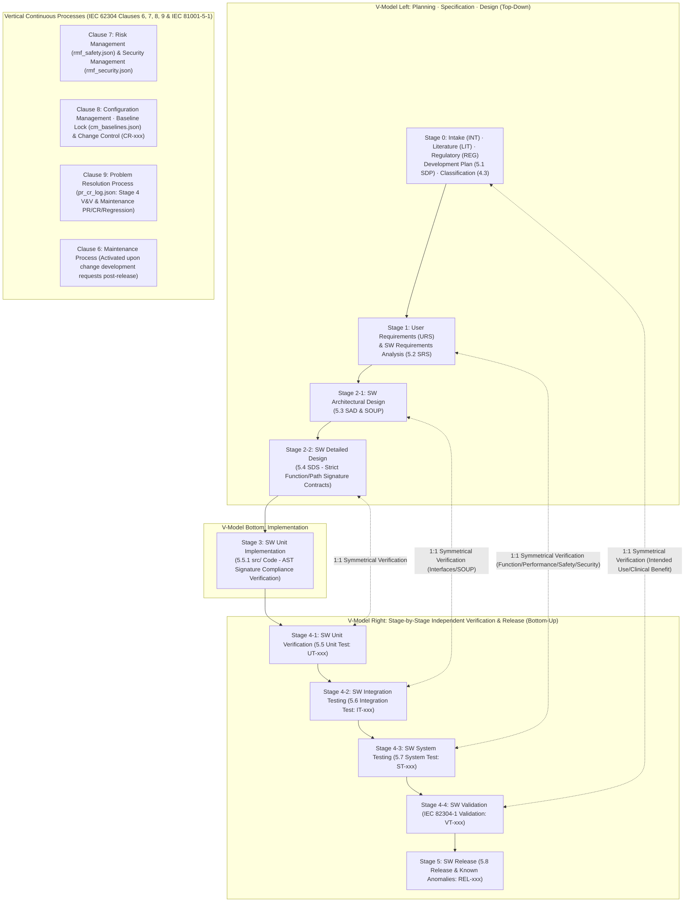

# 🏥 General-Purpose Medical Device SW Multi-Agent Framework Master Architecture & Roadmap (v3.2 Final)

This document serves as the final master blueprint for the Antigravity-based general-purpose medical device software development multi-agent framework, executing the full pipeline from initial user intake, preliminary literature research, and dynamic Software Development Plan (SDP) formulation through the **IEC 62304 full clauses (Clauses 4~9) V-model lifecycle and continuous 2D processes of configuration, change, problem resolution, and risk management**.

> [!IMPORTANT]
> **Framework 4 Core Invariants (Finalized in 3rd Independent Audit)**
> 1. **Strict Single Ownership & Reverse Indexing Traceability**:
>    * Each file may only be modified (written) by its designated owner agent (`URS/SRS` by `1-A`, `SAD/SOUP/SDS` by `2-A`, `src/` by `3-A`, `TC/tests/` by `4-A`, `REL` by `5-A`, `rmf_safety` by Safety Risk Analyst, `rmf_security` by Security Risk Analyst, `audit_findings` by Auditor, `pr_cr_log` by Problem/Change Analyst).
>    * Risk, security, audit, and change agents never directly alter requirements or design specifications; **their output files feed as inputs (Read) to document owners (`1-A`, `2-A`, `3-A`, `4-A`), who make direct modifications**.
>    * To achieve bidirectional traceability without violating ownership, JSON files record only `traces_to` pointers directing downstream to upstream, while **upstream $\rightarrow$ downstream linkages (e.g., which `RC` is implemented or verified by which `SRS/SDS/TC`) are computed and verified via automatic reverse indexing by the Python engine (`dhf_cli.py`/`gatekeeper.py`)**.
> 2. **Strict Interface Contracts for Black-Box Unit/Integration Testing (`UT/IT`)**:
>    * To enable `4-A (Black-box Tester)`, who cannot view source code, to author unit (`UT`) and integration (`IT`) tests without `ImportError`/`TypeError`, `2-A (Architect)` must declare **exact target file paths (`target_file`), function/class signatures (`callable_signature`), I/O schemas, and exception contracts** in `03_sad_soup.json` and `04_sds.json`, strictly enforced by Stage 3 AST parsing for 100% code conformance.
> 3. **Clear Boundary between In-Development Iteration and Formal Post-Verification/Post-Release Change Control (IEC 62304 Clauses 6, 8, 9)**:
>    * **Prior to Implementation Completion (Stage 0 ~ Stage 3)**: Without heavy `PR/CR` issuance, document owners receiving feedback (`rmf_*`, `audit_findings`) immediately bump versions (`v+1`) and log rationale in `audit_history.jsonl`. Downstream re-review prompted by upstream version bumps is automatically governed by **Suspect Link checks** in the gatekeeper.
>    * **Post-Formal V&V Entry (Stage 4 Code Freeze) and Post-Release Maintenance (Clause 6)**: Any defect discovered during frozen Stage 4 testing or post-release modification strictly requires **`4-C (Problem & Change Analyst)` to issue Problem Reports (`PR-xxx`, Clause 9) and Change Requests / regression scopes (`CR-xxx`, Clauses 8.2/9.7) in `pr_cr_log.json`** before baseline locks are unlocked for modification and regression testing.
> 4. **Tool Self-Validation (ISO 13485 Clause 4.1.6, ISO/TR 80002-2 & FDA CSA)**: All agent deliverables pass through deterministic Python management tools (`dhf_cli.py`), automated checkpoints (`gatekeeper.py`), and Human Sign-off, mechanically blocking direct file bypasses via hash chains (`audit_history.jsonl`).

---

## 1. IEC 62304 V-Model and Full Clauses (Clause 4 ~ 9) Complete Mapping Architecture



---

## 2. Dynamic Software Development Plan (`00_sdp_plan.json`) and Dynamic I/O Binding by Device Category

1. **Intake Interview (`0-0` Agent)**: Clarifies missing essential information from initial free-form requests (patient population, clinical environment, hardware presence, AI presence, network connectivity, new development vs. legacy SW maintenance) to finalize the official intake specification (`00_intake.json`).
2. **Dynamic I/O Configuration Based on Standard Workflow Template (`0-C` Agent)**:
   * When configuring `workflow_steps` in `00_sdp_plan.json` according to device safety classification (Class A/B/C) and multi-option switches (AND combinations allowed), **the list of conditional files (`opt_*.json`) each agent reads and writes is dynamically bound**:
     * **AI/ML Included (`ai_ml`)**: Activates `opt_ai_spec.json` (`DAT-xxx` dataset quality, training reproducibility, PCCP boundary).
     * **Embedded Hardware/Alarm Included (`SiMD` / `alarm_system`)**: Activates `opt_simd_alarm.json` (`HSI-xxx` hardware-SW interface, `ALM-xxx` IEC 60601-1-8 alarm specification).
     * **GUI-Centric Device (`gui_usability_adv`)**: Activates `opt_usability_gui.json` (`UE-xxx` use error scenarios, formative/summative evaluation protocols).
     * *(When multiple options are enabled simultaneously, `1-E` generates all active `opt_*.json` files, injected concurrently into Read lists of all relevant agents across Stages 1~5).*

---

## 3. Comprehensive Specifications per Agent [Role · Input (Read) · Output (Write Exclusive) · Operating Mechanism]

### 3.1 Overall Orchestration · Stage 0 (Planning & SDP Formulation)

| Agent | Core Role | 📖 Input (Read-Only) | ✍️ Output (Write - Exclusive) | ⚙️ Specific Operation Mode |
| :--- | :--- | :--- | :--- | :--- |
| **👑 0. Orchestrator** | Direct workflow execution and manage state transitions | • `00_sdp_plan.json`<br>• `audit_findings.json`<br>• `pr_cr_log.json`<br>• Automated gatekeeper results | • `00_sdp_plan.json` *(Update progress `status`)*<br>• `cm_baselines.json` *(Record baseline snapshot and lock)* | • Does not author documents or write code directly.<br>• Invokes agents according to sequence and dynamic I/O lists defined in `00_sdp_plan.json`.<br>• Upon risk/security/audit/problem (`PR/CR`) outputs, triggers feedback loops feeding output files to document owners (`1-A`, `2-A`, `3-A`, `4-A`) for revision. |
| **0-0. Intake Agent** | Receive development requests and conduct interviews for required info | • User initial free-form request<br>• (Upon `0-D` rejection) `audit_findings.json` | • **`00_intake.json`** (`INT-xxx`: Intended use, indications, patient population, environment, new/maintenance mode) | • Identifies gaps in initial request, conducts interactive interviews to confirm details, and generates foundational `00_intake.json`. |
| **0-A. Literature Researcher** | Investigate relevant clinical and engineering literature | • `00_intake.json`<br>• `audit_findings.json` | • **`00_literature.json`** (`LIT-xxx`: Standard algorithms, clinical performance criteria, predicate device adverse events) | • Conducts technical and State of the Art literature research based on Intended Use (`INT-xxx`) from `00_intake.json`. |
| **0-B. Regulatory Strategist** | Classify safety class (Clause 4.3) and derive applicable standards | • `00_intake.json`<br>• `00_literature.json`<br>• `audit_findings.json` | • **`00_regulatory.json`** (`REG-xxx`: Class A/B/C, FDA Basic/Enhanced, applicable standards list) | • Analyzes intended use and literature evidence to derive device type (SaMD/SiMD), safety classification, and mandatory/optional standards (security, AI, alarms, device-specific standards). |
| **0-C. SDP Planner** | Formulate development plan (Clause 5.1) and dynamic workflow/IO binding | • `00_intake.json`<br>• `00_literature.json`<br>• `00_regulatory.json`<br>• `audit_findings.json` | • **`00_sdp_plan.json`** (`SDP-xxx` plan + standard template based `workflow_steps` and **dynamic I/O list**) | • Defines development languages/tools, risk evaluation matrix criteria, configuration/change management plan (Clause 8), and verification acceptance criteria.<br>• Binds executing agents with **file lists each agent reads and writes (including all active `opt_*.json`)**. |
| **0-D. Stage 0 Auditor** | Audit planning and development plan (Clause 5.1) | • `00_intake.json`, `00_literature.json`, `00_regulatory.json`, `00_sdp_plan.json` | • **`audit_findings.json`** (`AUD-xxx`: `PASS` or `REJECT`) | • Evaluates validity of safety classification against intended use and checks completeness of workflow and dynamic I/O assignments in SDP. |

### 3.2 Stage 1: SW Requirements Analysis (IEC 62304 Clauses 5.2 & 7.1)

| Agent | Core Role | 📖 Input (Read-Only) | ✍️ Output (Write - Exclusive) | ⚙️ Specific Operation Mode |
| :--- | :--- | :--- | :--- | :--- |
| **1-A. Requirements Author** | Author and revise User Requirements (`URS`) and SW Requirements (`SRS`, Clause 5.2) | **[Initial Draft]**<br>• Stage 0 full JSON<br>**[Feedback/Change Revision Additional Inputs]**<br>• **`rmf_safety.json`**<br>• **`rmf_security.json`**<br>• **`audit_findings.json`**<br>• *(Stage 4/Maintenance changes)* **`pr_cr_log.json`**<br>• *(Dynamic)* All active `opt_*.json` | • **`01_urs.json`** (`URS-xxx`)<br>• **`02_srs.json`** (`SRS-xxx`)<br>*(⚠️ Only 1-A may modify requirements files!)* | • **Primary Action (Draft)**: Authors draft functional/performance/interface requirements (v1) from Stage 0 documents.<br>• **Secondary Action (Feedback Incorporation)**: **Reads as inputs** files output by Risk (`1-B`), Security (`1-C`), Option (`1-E`), Auditor (`1-D`), or Stage 2 (`2-B`/`2-C`) to directly incorporate safety/security/option/derived requirements into `02_srs.json` (v+1) and links `traces_to: {"RC-xxx": ver}` pointers. |
| **1-B. Safety & Usability Risk Analyst** | Initial Preliminary Hazard Analysis (PHA) and Use Error analysis | • Stage 0 JSON, `01_urs.json`, **`02_srs.json`**<br>• **`rmf_security.json`** *(Safety-security conflict check)*<br>• *(Dynamic)* `opt_*.json`, `audit_findings.json` | • **`rmf_safety.json`** (`HAZ-SAF-xxx`, `RC-SAF-xxx`: Initial risk scores and safety control measures) | • Identifies clinical risks and use errors from requirements draft, recording only in `rmf_safety.json`. **(Never touches `02_srs.json` directly!)**<br>• Cross-checks after `1-C` to ensure security measures do not compromise clinical safety. |
| **1-C. Security Risk Analyst** | Initial cybersecurity threats and security controls derivation | • Stage 0 JSON, `01_urs.json`, **`02_srs.json`**<br>• `rmf_safety.json`, `audit_findings.json` (`+ opt_*.json`) | • **`rmf_security.json`** (`HAZ-SEC-xxx`, `RC-SEC-xxx`: Security threats and controls) | • Identifies required security controls (data protection, authentication, access control, audit logging) from requirements draft, outputting only to `rmf_security.json` ($\rightarrow$ delivered as input to `1-A`). |
| *(Dynamic Conditional)*<br>**1-E. Option Domain Author**<br>(AI / SiMD·Alarm / GUI) | Author specialized domain specifications activated in SDP (Multi-AND supported) | • `00_sdp_plan.json`, `01_urs.json`, `02_srs.json`<br>• `rmf_safety.json`, `rmf_security.json`, `audit_findings.json` | • Exclusive output of all active option files:<br>  - **`opt_ai_spec.json`** (`DAT-xxx`)<br>  - **`opt_simd_alarm.json`** (`HSI/ALM-xxx`)<br>  - **`opt_usability_gui.json`** (`UE-xxx`) | • Outputs all option domain specifications enabled in `00_sdp_plan.json` into respective `opt_*.json` files ($\rightarrow$ delivered as inputs to `1-A`, `1-B`, `1-C` and subsequent stages). |
| **1-D. Stage 1 Auditor** | Requirements verification (Clause 5.2.6) and initial risk/security audit | • Stage 0~1 full JSON files (`+ opt_*.json`) | • **`audit_findings.json`** (`AUD-xxx`) | • Audits and records whether all risk/security controls (`RC`) and option specifications were incorporated by `1-A` into `02_srs.json` and are testable without ambiguity. |

### 3.3 Stage 2: SW Architectural Design (Clause 5.3) and Detailed Design (Clause 5.4)

| Agent | Core Role | 📖 Input (Read-Only) | ✍️ Output (Write - Exclusive) | ⚙️ Specific Operation Mode |
| :--- | :--- | :--- | :--- | :--- |
| **2-A. Software Architect** | Dedicated authoring/revision of Architecture (`SAD`, Clause 5.3), `SOUP` (Clause 5.3.3), Detailed Design (`SDS`, Clause 5.4) | **[Initial Draft Design]**<br>• `00_sdp_plan.json`, `02_srs.json`, `rmf_safety.json`, `rmf_security.json` (`+ opt_*.json`)<br>**[Feedback/Change Revision Additional Inputs]**<br>• Updated **`rmf_safety.json`**, **`rmf_security.json`** by `2-B`/`2-C`<br>• **`audit_findings.json`**, *(Stage 4/Maintenance)* **`pr_cr_log.json`** | • **`03_sad_soup.json`** (`SAD-xxx`, `SOUP-xxx` - including module safety class segregation)<br>• **`04_sds.json`** (`SDS-xxx` - **Strict file paths, function signatures, I/O & exception contracts mandatory!**)<br>*(⚠️ Only 2-A may modify design files!)* | • **Primary Action (Draft)**: Authors architectural modules/interfaces (`SAD`), external libraries (`SOUP`), and **detailed design (`SDS`) with strict function signature contracts** directly callable by black-box `UT/IT`.<br>• **Secondary Action (Feedback Incorporation)**: **Reads as inputs** outputs from `2-B (DFMEA)`, `2-C (Security)`, and `2-D (Auditor)` to refine design specifications directly. |
| **2-B. DFMEA Risk Analyst** | Architectural, detailed design, and SOUP defect safety risk analysis (Clauses 7.1/7.2) | • `00_sdp_plan.json`, `02_srs.json`<br>• **`03_sad_soup.json`**, **`04_sds.json`**<br>• `rmf_*.json` (`+ opt_*.json`) | • **`rmf_safety.json`** (Design-stage new `HAZ-SAF-xxx`, `RC-SAF-xxx`) | • Analyzes risks of module failures, communication breakdowns, and `SOUP` malfunctions, outputting only to `rmf_safety.json`. **(Direct modification of design or requirements strictly prohibited!)**<br>• If new `RC` requires derived requirements, Orchestrator feeds `rmf_safety.json` into `1-A` (`SRS` addition) $\rightarrow$ `2-A` (`SDS` modification). |
| **2-C. Threat & SOUP Security Analyst** | Architectural threat modeling (STRIDE) and SOUP CVE vulnerability analysis | • `00_sdp_plan.json`, `02_srs.json`<br>• **`03_sad_soup.json`**, **`04_sds.json`**<br>• `rmf_*.json` (`+ opt_*.json`) | • **`rmf_security.json`** (Design/SOUP security `HAZ-SEC-xxx`, `RC-SEC-xxx`) | • Analyzes data flow threats and `SOUP` vulnerabilities, outputting only to `rmf_security.json` ($\rightarrow$ delivered as inputs to `1-A` and `2-A` for incorporation). |
| **2-D. Stage 2 Auditor** | Architecture verification (Clause 5.3.6) and detailed design verification (Clause 5.4.4) audit | • Stage 0~2 full JSON files (`+ opt_*.json`) | • **`audit_findings.json`** (`AUD-xxx`) | • Audits `SRS` $\leftrightarrow$ `SAD` $\leftrightarrow$ `SDS` traceability, safety class segregation, and completeness of function signature contracts in `04_sds.json`. |

### 3.4 Stage 3: SW Unit Implementation (IEC 62304 Clause 5.5.1)

| Agent | Core Role | 📖 Input (Read-Only) | ✍️ Output (Write - Exclusive) | ⚙️ Specific Operation Mode |
| :--- | :--- | :--- | :--- | :--- |
| **3-A. Developer** | Implement and modify source code based on detailed design (`SDS`) signature contracts | **[Initial Implementation]**<br>• `00_sdp_plan.json`, `03_sad_soup.json`, `04_sds.json` (`+ opt_*.json`)<br>**[Feedback/Bug Fix Additional Inputs]**<br>• **`rmf_safety.json`**, **`rmf_security.json`**<br>• **`audit_findings.json`**, *(Stage 4/Maintenance)* **`pr_cr_log.json`** | • **`src/` source code files**<br>(`# @traces: SDS-xxx@ver` mandatory)<br>*(⚠️ Only 3-A may modify source code!)* | • Implements code adhering 100% to exact file paths, function signatures, and exception contracts defined in approved `04_sds.json`.<br>• Receives outputs from `3-B`, `3-C`, or Stage 4 Problem Reports (`PR/CR`) **as inputs** to directly fix source code. |
| **3-B. Code Safety & SAST Analyst** | Implementation code static analysis (SAST) and architecture-derived risk analysis | • `00_sdp_plan.json`, `04_sds.json`, **`src/` source code**, `rmf_*.json` (`+ opt_*.json`) | • **`rmf_safety.json`**, **`rmf_security.json`** *(Upon discovering new design/code-level risks)* | • Records newly induced safety/security risks (ISO 14971 / IEC 81001-5-1) arising from implementation into risk files.<br>• *(Simple coding mistakes or specification mismatch bugs are not registered as HAZ in `rmf_*.json`; instead, `3-C` auditor and gatekeeper instruct `3-A` to fix immediately via `audit_findings.json`)* |
| **3-C. Stage 3 Auditor** | Unit implementation rules (Clauses 5.5.2~5.5.4) and secure coding audit | • Stage 2~3 full files (`03_sad_soup`, `04_sds`, `rmf_*`, `src/`, `+ opt_*.json`) | • **`audit_findings.json`** (`AUD-xxx`) | • Audits compliance with `04_sds.json` signature contracts, resolution of secure coding/static analysis findings, and absence of unapproved `SOUP` imports. |

### 3.5 Stage 4 ~ 5: V-Model 4-Tier Independent Verification (Clauses 5.5 ~ 5.7, Validation) · Problem Resolution (Clause 9) · Release (Clause 5.8)

| Agent | Core Role | 📖 Input (Read-Only) | ✍️ Output (Write - Exclusive) | ⚙️ Specific Operation Mode |
| :--- | :--- | :--- | :--- | :--- |
| **4-A. Black-box V&V Tester** | Author V-model 4-tier test specifications (`05_tc.json`) and test code | • `00_intake.json`, `00_sdp_plan.json`<br>• `01_urs.json` ($\rightarrow$ For authoring `VT`)<br>• `02_srs.json`, `rmf_*.json` ($\rightarrow$ For authoring `ST` and fault-injection tests)<br>• `03_sad_soup.json` ($\rightarrow$ For authoring `IT` integration tests)<br>• `04_sds.json` ($\rightarrow$ For signature-contract based `UT` unit verification)<br>• (`+ opt_*.json`), `audit_findings.json`, `pr_cr_log.json`<br>*(🚫 **Never view `src/` source code!**)* | • **`05_tc.json`**<br>(`UT-xxx` unit test, `IT-xxx` integration test, `ST-xxx` system test, `VT-xxx` validation)<br>• **`tests/` test code**<br>(`# @verifies: ...`) | • Authors 4-tier tests (`UT` $\rightarrow$ `IT` $\rightarrow$ `ST` $\rightarrow$ `VT`) and risk control fault-injection (negative) tests based on exact `04_sds.json` signature contracts and upstream specifications without viewing source code.<br>• Executes tests via `dhf_cli.py run-tests --redact-src`. |
| **4-B. Residual Risk Evaluator**<br>(**ISO 14971 Clauses 7.4 & 8**) | Final closure of safety/security residual risks based on verification results | • `00_intake.json`, `00_literature.json`<br>• `rmf_safety.json`, `rmf_security.json`<br>• `05_tc.json` and **test execution pass reports** | • **`rmf_safety.json`** *(Final residual risk evaluation and benefit-risk conclusions)*<br>• **`rmf_security.json`** *(Final security residual risk determinations)* | • Verifies that all safety/security control measures (`RC`) have passed actual tests (`UT/IT/ST/VT`) and finalizes `rmf_*.json` confirming residual risks are acceptable against clinical benefits (`INT-xxx`). |
| **4-C. Problem & Change Analyst**<br>(**IEC 62304 Clauses 8.2 & 9**) | Issue `PR/CR` during Stage 4 official verification defects or maintenance (Clause 6) | • Test failure logs, `audit_findings.json`<br>• `01_urs.json` ~ `05_tc.json`, `rmf_*.json`, `src/` | • **`pr_cr_log.json`**<br>(`PR-xxx` Problem Reports, root cause/safety analysis, `CR-xxx` Change Requests and regression test scope) | • Creates `PR-xxx` (Clause 9.1) upon Stage 4 test failures or post-release maintenance changes, investigating responsible parties (`1-A`, `2-A`, `3-A`, `4-A`) (Clause 9.2).<br>• Computes impacted modules and **regression test lists (Clause 9.7)** to output `CR-xxx` (Clause 8.2) ($\rightarrow$ delivered as input to relevant document owners). |
| **5-A. Release Author**<br>(**IEC 62304 Clause 5.8**) | Dedicated authoring of release document (`06_release.json`) and remaining anomaly specifications | • Full JSON files (including finalized `rmf_*.json`) + test/regression pass reports + `pr_cr_log.json` | • **`06_release.json`** (`REL-xxx`: Release version, Known Anomalies and safety justifications, build environment archive)<br>*(⚠️ Exclusive modification of 06_release.json only!)* | • Reviews finalized `rmf_*.json` and `pr_cr_log.json`, compiles safety justifications for deferred minor anomalies (`DEFERRED` Known Anomalies) and final configuration baseline, and outputs `06_release.json`. |
| **5-B. Final Release Auditor** | Final audit of full-lifecycle V-model traceability (RTM), configuration management (Clause 8), and problem resolution (Clause 9) | • All files in `store/` + `audit_history.jsonl` + test reports | • **`audit_findings.json`** (Final release recommendation report) | • Conducts final audit of 100% bidirectional V-model coverage, ensures all `PR/CR`s are `CLOSED` or safety-justified under `DEFERRED` in `06_release.json`, and verifies baseline hash integrity. |

---

## 4. Complete Data Store (`store/`) File Structure (Step 1 Schema)

```text
📁 project_root/
 ├── 📁 store/                        # [Raw Data Store - Modified exclusively via dhf_cli.py]
 │    ├── 🔒 .dhf.lock                # OS file lock for concurrency control (fcntl.flock)
 │    ├── 📄 00_intake.json           # [0-0 Exclusive] Development intake and intended use (INT-xxx)
 │    ├── 📄 00_literature.json       # [0-A Exclusive] Technical and clinical literature research (LIT-xxx)
 │    ├── 📄 00_regulatory.json       # [0-B Exclusive] Safety class (Clause 4.3) and regulatory standards (REG-xxx)
 │    ├── 📄 00_sdp_plan.json         # [0-C / Orchestrator] Development plan (Clause 5.1, SDP-xxx) + Dynamic workflow & I/O binding
 │    ├── 📄 01_urs.json              # [1-A Exclusive] User requirements (URS-xxx)
 │    ├── 📄 02_srs.json              # [1-A Exclusive] SW requirements specification (Clause 5.2, SRS-xxx)
 │    ├── 📄 03_sad_soup.json         # [2-A Exclusive] SW architecture (Clause 5.3, SAD-xxx) and external libraries (SOUP-xxx)
 │    ├── 📄 04_sds.json              # [2-A Exclusive] SW detailed design (Clause 5.4, SDS-xxx - strict signature contracts included)
 │    ├── 📄 05_tc.json               # [4-A Exclusive] V-model 4-tier test specifications (UT-xxx, IT-xxx, ST-xxx, VT-xxx)
 │    ├── 📄 06_release.json          # [5-A Exclusive] SW release and known anomalies specification (Clause 5.8, REL-xxx)
 │    ├── 📄 rmf_safety.json          # [1-B/2-B/3-B/4-B Exclusive] Full-lifecycle safety/usability risk management (Clause 7, HAZ-SAF-xxx, RC-SAF-xxx)
 │    ├── 📄 rmf_security.json        # [1-C/2-C/3-B/4-B Exclusive] Full-lifecycle cybersecurity risk management (HAZ-SEC-xxx, RC-SEC-xxx)
 │    ├── 📄 audit_findings.json      # [Auditors Exclusive] Stage-by-stage independent quality audit findings and verdicts (AUD-xxx)
 │    ├── 📄 pr_cr_log.json           # [4-C Exclusive] Problem reports (Clause 9, PR-xxx) and change control/impact (Clause 8.2, CR-xxx)
 │    ├── 📄 cm_baselines.json        # [Orchestrator/Engine Exclusive] Configuration baseline snapshots and lock status (Clauses 8.1/8.3, BL-xxx)
 │    ├── 📄 opt_ai_spec.json         # [Conditional 1-E Exclusive] AI/ML data, model, and PCCP specification (DAT-xxx)
 │    ├── 📄 opt_simd_alarm.json      # [Conditional 1-E Exclusive] Hardware interface (HSI-xxx) and alarm (ALM-xxx) specification
 │    ├── 📄 opt_usability_gui.json   # [Conditional 1-E Exclusive] GUI usability evaluation protocol specification (UE-xxx)
 │    └── 📜 audit_history.jsonl      # [Engine Auto-Recorded] 5W1H + hash chain (prev_hash, state_hash) full version history ledger
 ├── 📁 src/                          # [3-A Exclusive] Implementation source code (# @traces: SDS-001@1)
 ├── 📁 tests/                        # [4-A Exclusive] Unit/integration/system/validation test code (# @verifies: ...)
 └── 📁 docs/                         # [Auto-Generated] Regulatory consolidated Markdown documents output in 1 second via reverse indexing from store/
```

---

## 5. Framework Implementation 5-Step Roadmap

| Step | Goal | Core Deliverables & Verification Content |
| :--- | :--- | :--- |
| **Step 1** | **Finalize Data Store & Detailed Identifier Schemas** | JSON field specifications for `store/` files above (including `04_sds.json` function signature contracts) and V-model traceability link rules finalized |
| **Step 2** | **Implement Python DHF Engine & Automated Checkpoint (+ Self-Validation)** | `dhf_cli.py` (exclusive ownership checks, reverse indexing, hash chain, markdown rendering) + `gatekeeper.py` (V-model bidirectional traceability, AST signature match, version, empty code, SOUP checks) + **ISO/TR 80002-2 Self-Validation Tests (`test_framework_csa.py`)** |
| **Step 3** | **Stage 0 ~ Stage 2 Trial Run (Intake $\rightarrow$ SDP $\rightarrow$ Requirements $\rightarrow$ Design)** | Sample medical device intake verifying `0-0` interview through `1-A`/`2-A` risk/security/audit feedback loops |
| **Step 4** | **Stage 3 ~ Stage 5 Integration (Implementation $\rightarrow$ V-Model 4-Tier Verification $\rightarrow$ PR/CR Change Management $\rightarrow$ Release)** | AST signature checks, black-box testing (`UT/IT/ST/VT`), defect handling via `4-C` `PR/CR` issuance and regression testing loops, final release verification |
| **Step 5** | **Modularize Antigravity General-Purpose Package (`.agents/`)** | Portable packaging of `Rules`, `Skills`, and `Hooks` ready for deployment to any project |
