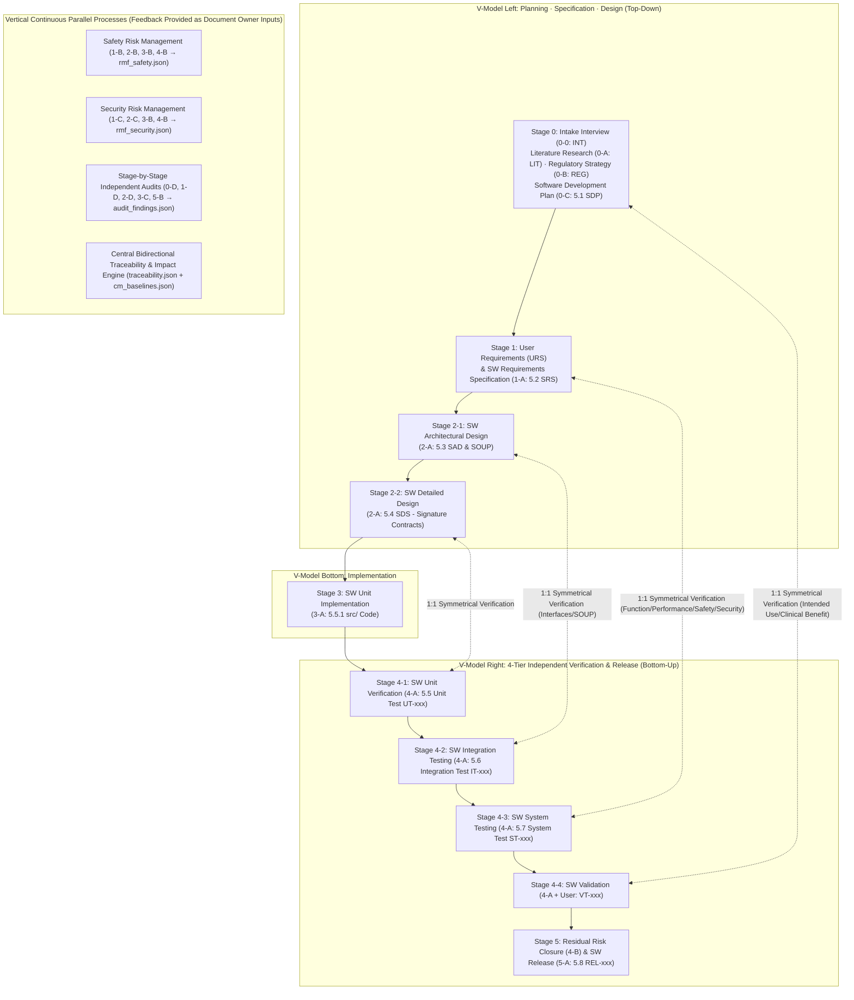

# 🏥 SaMD / Medical Device SW Development Multi-Agent Framework Master Roadmap

## 1. Project Goal and Core Philosophy
- Establish an **Antigravity-based multi-agent framework** universally applicable to the development of **any medical device software (SaMD and embedded SiMD if needed)**, rather than a single specific software
- Systematically orchestrate the main pipeline spanning initial user intake (interactive interview), preliminary literature/regulatory research, **tailored Software Development Plan (SDP) formulation**, and **IEC 62304 V-model based specification (URS/SRS/SAD/SOUP/SDS) $\rightarrow$ implementation $\rightarrow$ 4-tier independent verification (UT/IT/ST/VT) $\rightarrow$ release**, alongside continuous 2-dimensional (2D) processes of **risk management, cybersecurity, configuration management, change control, and independent audit**.
- **Non-Product SW Self-Validation for Quality Systems (ISO 13485 Clause 4.1.6, ISO/TR 80002-2 & FDA CSA Compliance)**:
  - This framework is non-product software (QMS Tool) used for design, development, verification, and documentation in a medical device quality management system (QMS).
  - Artifacts generated by non-deterministic AI agents are always treated as **'Drafts'**, with all data storage and validation subjected to **deterministic Python management tools (`dhf_cli.py`), automated checkpoints (`gatekeeper.py`)**, and stage-by-stage **Human Sign-off**.
  - Built-in framework requirements (`TOOL-REQ`), tool risk analysis, and checkpoint self-validation tests (`test_framework_csa.py`) are incorporated to immediately present a **Computer Software Assurance (CSA) Report** to auditors.

---

## 2. Applicable Standards Architecture (Core + Profile Switches + Cross-cutting Risk Matrix)

At project inception (Stage 0), the development request characteristics are analyzed to assemble a tailored combination across 3 tiers of standards below.

### 2.1 Absolute Core Standards (Mandatory for All Projects)
| Standard / Guideline | Role and Application Method in Framework |
| :--- | :--- |
| **IEC 62304** (Edition 1 Amd1 & Edition 2 preparedness) | SW lifecycle processes (Clauses 4 through 9 and graded deliverables/rigor by Class A / B / C safety classification) |
| **ISO 14971 & ISO 24971** | Full-lifecycle safety risk management (Initial risk $S_1 \times P_1$ $\rightarrow$ Mandatory control priority 1>2>3 $\rightarrow$ Verification linkage $\rightarrow$ Residual risk $S_2 \times P_2$ and benefit-risk evaluation) |
| **ISO 13485 (Clauses 4.1.6, 7.3)** | QMS design and development controls, bidirectional traceability (RTM), development tool validation |
| **IEC 62366-1** | Basic usability engineering (Identification and control of Use Errors across UI/alarms/APIs/manuals) |
| **IEC 81001-5-1 & FDA OTS** | Basic security lifecycle, secure coding, **prevention and verification of unapproved SOUP/OTS (external open source libraries)** |
| **ISO/TR 80002-2 & FDA CSA** | Framework deterministic Gate verification and hash chain based audit trail |
| **IMDRF N41 & ISO 20416** | Intended Use (`INT`) $\leftrightarrow$ Clinical Evaluation and Post-Market Surveillance (PMS) linkage |

### 2.2 Device Type Branching and Feature Option Switches (Profile Settings in `00_sdp_plan.json`)
- **Device Form Factor (Select 1)**:
  - `SaMD` (Software as a Medical Device) $\rightarrow$ **IEC 82304-1** (Health software system requirements and product validation)
  - `SiMD` (Software in a Medical Device / Embedded) $\rightarrow$ **IEC 60601-1 (Clause 14 PEMS)** (Hardware-SW interface and electrical/mechanical fail-safe)
- **Target Regulatory Jurisdictions (Multi-select)**: `MFDS`, `FDA` (2023 Basic/Enhanced documentation levels), `CE_MDR`
- **Feature Option Switches (Multi-select AND combinations allowed)**:
  - `cybersecurity_adv`: **ANSI/AAMI SW96**, FDA/MFDS security guidance (STRIDE threat modeling, CVE vulnerability analysis, encryption/audit log/penetration testing)
  - `ai_ml`: **BS/AAMI 34971 (ISO/TS 24971-2)**, **GMLP**, **ISO/IEC 5259** (Data quality), **ISO/IEC 42001**, **FDA PCCP** (Predetermined Change Control Plan), **EU AI Act**
  - `gui_usability_adv`: **IEC 62366-1 In-depth** (Formative and Summative evaluation protocols based on wireframes/prototypes)
  - `alarm_system`: **IEC 60601-1-8** (Medical alarm priorities High/Med/Low, visual/auditory signal specifications, pause safety conditions)
  - `interoperability`: **HL7 FHIR / DICOM**, **HIPAA / GDPR / Privacy Laws** (De-identification/pseudonymization verification)
  - **Product-Specific Standards**: Dynamically derived during Stage 0 literature/regulatory research based on product classification (e.g., ECG AAMI EC57)

### 2.3 Cross-cutting Risk Matrix across Options
- **`[ai_ml]` $\times$ `[cybersecurity_adv]` (AAMI CR515)**: Enforce defense requirements against data poisoning, adversarial attacks, and model extraction
- **`[ai_ml]` $\times$ `[IEC 62366-1 Usability]`**: Enforce display of confidence scores, explainable AI (XAI) rationale, and out-of-distribution (OOD) alerts to prevent automation bias in clinicians
- **`[ISO 14971 Safety]` $\times$ `[IEC 81001-5-1 Security]`**: Mandatory **Safety vs. Security tradeoff review** ensuring security controls (session locks, multi-factor auth, crypto latency) do not impede patient safety in emergency clinical workflows

---

## 3. Framework 5 Core Design Principles

### Principle 1: Software Development Plan (`00_sdp_plan.json`) = Orchestrator Execution Script & Dynamic I/O Binding
- Upon receiving a development request, `Stage 0` analyzes request characteristics to formulate a **Software Development Plan (`00_sdp_plan.json`)** specifying **custom workflow steps (`workflow_steps`), dynamic agent I/O file lists (including `opt_*.json`), and coding/risk/testing acceptance criteria**.
- **The Orchestrator agent treats this `00_sdp_plan.json` as its input (work order and state machine)** to direct all subsequent tasks sequentially. (To prevent arbitrary omission of mandatory stages, conditional steps are activated atop a pre-validated **standard workflow template DAG**.)

### Principle 2: Absolute Document Single Ownership & Feedback Input Loops
- **No agent may directly write to another agent's document**:
  - Requirements (`01_urs.json`, `02_srs.json`) are modified **exclusively by `1-A (Requirements Author)`**
  - Design specifications (`03_sad_soup.json`, `04_sds.json`) are modified **exclusively by `2-A (Architect)`**
  - Source code (`src/`) is modified **exclusively by `3-A (Implementation Developer)`**
  - Tests (`05_tc.json`, `tests/`) are modified **exclusively by `4-A (Black-box Tester)`**
  - Releases (`06_release.json`) are modified **exclusively by `5-A (Release Author)`**
- **Outputs of Risk, Security, and Audit $\rightarrow$ Cycle into Inputs of Document Authors**:
  - Safety risk agents output **only `rmf_safety.json`**, security risk agents output **only `rmf_security.json`**, and auditor agents output **only `audit_findings.json`**.
  - **These output files feed back as read-only inputs to document owners (`1-A`, `2-A`, `3-A`, `4-A`)**, who directly update their own documents (version `v+1`).

### Principle 3: Dedicated Central Bidirectional Traceability Ledger (`traceability.json`) Dual Management
- Scattering links (`traces_to`) solely inside individual files (`02_srs.json`, `04_sds.json`, code comments) introduces risk of link loss due to agent errors.
- Therefore, whenever items are registered/updated via the Python tool (`dhf_cli.py`), **bidirectional mappings `[Upstream ID@ver <-> Downstream ID@ver]` are explicitly recorded and managed in a dedicated central ledger `traceability.json`**, while the automated checkpoint (`gatekeeper.py`) cross-checks consistency and 100% top-down / bottom-up coverage against individual files.

### Principle 4: Pragmatic Configuration and Change Management (Eliminating Unnecessary Over-Engineering)
- **Prior to Final Release (During Development and Testing — Stage 0 ~ Stage 4)**:
  - Heavy formal Problem Report (PR)/Change Request (CR) sign-off workflows are not enforced when fixing bugs or refining earlier specifications during development/testing (IEC 62304 does not require this).
  - Instead, when an item already approved at an earlier Gate (e.g., `SRS-001` v1 $\rightarrow$ v2) is modified, the Python tool logs change rationale in `audit_history.jsonl` and **immediately flags all linked upstream/downstream documents, code, tests, and risk items as 'Suspect Links / Re-review Required' via `traceability.json`**.
  - Mechanically enforces that all linked items within impact scope must be reviewed, updated to the new version, and pass tests before clearing the next Gate (eliminating bureaucratic paperwork while guaranteeing 0 missed changes!).
- **After Final Release (During Maintenance and Version Upgrades — IEC 62304 Clauses 6, 8.2, 9)**:
  - Formal **Problem Report (`PR-xxx`) and Change Request (`CR-xxx`, `pr_cr_log.json`)** procedures are activated exclusively when modifying/maintaining existing software following the initial release (Release 1.0 baseline lock).

### Principle 5: Black-box Verification (`4-A`) Isolation Guarantee & Human-Friendly Manual Validation (`VT`) Support
- **Design Signature Contracts for Black-box `UT/IT`**: To enable `4-A (Tester)`, who cannot view source code, to author unit (`UT`) and integration (`IT`) tests without `ImportError`, `2-A (Architect)` must declare **exact file paths, function/class signatures, I/O types, and exception contracts** in `04_sds.json`, verified 100% against code by Stage 3 AST parsing. (Error messages during test runs also mask `src/` code).
- **Agent Assistance and Proxy Recording for Manual Validation (`VT-xxx`)**:
  - End-to-end clinical scenarios capable of software simulation are verified primarily via automated agent scripts.
  - For manual tests (`VT-xxx`) requiring humans to view screens or manipulate devices, rather than demanding complex JSON authoring, the agent creates a **readable Markdown checklist table (`[ ] Pass / [ ] Fail`)**; **when humans check items or convey results via chat, the agent records official JSON records (`05_tc.json`) and reports on their behalf**.

---

## 4. IEC 62304 V-Model Workflow and Detailed Specification Table per Agent



### 4.1 Stage 0: Intake · Literature · Regulatory Strategy · Development Plan (SDP) Formulation

| Agent | Core Role | 📖 Input (Read-Only) | ✍️ Output (Write - Exclusive) | ⚙️ Specific Operation Mode |
| :--- | :--- | :--- | :--- | :--- |
| **👑 0. Orchestrator** | Direct workflow execution and manage state | • `00_sdp_plan.json`<br>• `traceability.json`<br>• `audit_findings.json`<br>• Automated gatekeeper results | • `00_sdp_plan.json` *(Update progress `status`)*<br>• `cm_baselines.json` *(Record baseline snapshot upon Stage pass)* | • Does not author documents or write code directly.<br>• Invokes agents according to sequence and dynamic I/O lists defined in `00_sdp_plan.json`.<br>• Upon risk/security/audit findings or change impacts (`Suspect Link`), triggers feedback loops feeding input files to document owners (`1-A`, `2-A`, `3-A`, `4-A`) for revision. |
| **0-0. Intake Agent** | Receive development requests and conduct interviews for required info | • User initial free-form request (chat or draft file)<br>• (Upon `0-D` rejection) `audit_findings.json` | • **`00_intake.json`** (`INT-xxx`: Intended use, indications, patient population, use environment, HW/AI/network presence, new/maintenance mode) | • Identifies gaps essential for device classification and planning from initial request, conducts interactive interviews to confirm details, and generates official intake specification (`00_intake.json`). |
| **0-A. Literature Researcher** | Investigate relevant clinical and engineering literature | • `00_intake.json`<br>• `audit_findings.json` | • **`00_literature.json`** (`LIT-xxx`: Standard algorithms, clinical performance criteria, predicate device adverse events/hazards) | • Conducts web/literature research based on Intended Use (`INT-xxx`) from `00_intake.json` to record technical rationale and State of the Art data. |
| **0-B. Regulatory Strategist** | Classify safety class (Clause 4.3) and derive applicable standards | • `00_intake.json`<br>• `00_literature.json`<br>• `audit_findings.json` | • **`00_regulatory.json`** (`REG-xxx`: Class A/B/C, FDA Basic/Enhanced, applicable standards and option switch lists) | • Analyzes intended use and literature evidence to derive device type (SaMD/SiMD), safety classification, and mandatory/optional standards (cybersecurity, AI, alarms, device-specific standards). |
| **0-C. SDP Planner** | Formulate development plan (Clause 5.1) and dynamic workflow/IO binding | • `00_intake.json`<br>• `00_literature.json`<br>• `00_regulatory.json`<br>• `audit_findings.json` | • **`00_sdp_plan.json`** (`SDP-xxx` plan + standard template based `workflow_steps` and **dynamic I/O list**) | • Defines development languages/tools, risk matrix criteria, configuration/change rules, and verification acceptance criteria.<br>• Binds agent execution order tailored to device characteristics with **file lists each agent reads and writes (including all active `opt_*.json`)**. |
| **0-D. Stage 0 Auditor** | Audit planning and development plan (Clause 5.1) | • `00_intake.json`, `00_literature.json`, `00_regulatory.json`, `00_sdp_plan.json` | • **`audit_findings.json`** (`AUD-xxx`: `PASS` or `REJECT` and re-work targets) | • Evaluates validity of safety classification against intended use and checks completeness of workflow and dynamic I/O assignments in SDP. (Records only in `audit_findings.json` without direct edits). |

### 4.2 Stage 1: User Requirements (`URS`) and SW Requirements (`SRS`) Analysis (IEC 62304 Clauses 5.2 & 7.1)

| Agent | Core Role | 📖 Input (Read-Only) | ✍️ Output (Write - Exclusive) | ⚙️ Specific Operation Mode |
| :--- | :--- | :--- | :--- | :--- |
| **1-A. Requirements Author** | Author and revise User Requirements (`URS`) and SW Requirements (`SRS`, Clause 5.2) | **[Initial Draft]**<br>• Stage 0 full JSON<br>**[Feedback/Change Revision Additional Inputs]**<br>• **`rmf_safety.json`**<br>• **`rmf_security.json`**<br>• **`audit_findings.json`**<br>• *(Dynamic)* All active `opt_*.json`<br>• *(During Maintenance)* `pr_cr_log.json` | • **`01_urs.json`** (`URS-xxx`)<br>• **`02_srs.json`** (`SRS-xxx`)<br>*(⚠️ Only 1-A may modify requirements files!)* | • **Primary Action (Draft)**: Authors draft functional/performance/interface requirements (v1) from Stage 0 documents.<br>• **Secondary Action (Feedback Incorporation)**: **Reads as input** files output by Risk (`1-B`), Security (`1-C`), Option (`1-E`), Auditor (`1-D`), or downstream stages (`2-B`/`2-C`) to directly incorporate safety/security/option/derived requirements into `02_srs.json` (v+1). |
| **1-B. Safety & Usability Risk Analyst** | Initial Preliminary Hazard Analysis (PHA) and Use Error analysis | • Stage 0 JSON, `01_urs.json`, **`02_srs.json`**<br>• **`rmf_security.json`** *(Safety-security conflict check)*<br>• *(Dynamic)* `opt_*.json`, `audit_findings.json` | • **`rmf_safety.json`** (`HAZ-SAF-xxx`, `RC-SAF-xxx`: Initial risk scores and safety control measures) | • Identifies clinical hazards and use errors from requirements draft, recording only in `rmf_safety.json`. **(Never touches `02_srs.json` directly!)**<br>• Cross-checks after `1-C` to ensure security measures do not compromise clinical safety. |
| **1-C. Security Risk Analyst** | Initial cybersecurity threats and security controls derivation | • Stage 0 JSON, `01_urs.json`, **`02_srs.json`**<br>• `rmf_safety.json`, `audit_findings.json` (`+ opt_*.json`) | • **`rmf_security.json`** (`HAZ-SEC-xxx`, `RC-SEC-xxx`: Security threats and controls) | • Identifies required security controls (data protection, authentication, access control, audit logging) from requirements draft, outputting only to `rmf_security.json` ($\rightarrow$ forwarded as input to `1-A`). |
| *(Dynamic Conditional)*<br>**1-E. Option Domain Author**<br>(AI / SiMD·Alarm / GUI) | Author specialized domain specifications activated in SDP (Multi-AND supported) | • `00_sdp_plan.json`, `01_urs.json`, `02_srs.json`<br>• `rmf_safety.json`, `rmf_security.json`, `audit_findings.json` | • Exclusive output of all active option files:<br>  - **`opt_ai_spec.json`** (`DAT-xxx`)<br>  - **`opt_simd_alarm.json`** (`HSI/ALM-xxx`)<br>  - **`opt_usability_gui.json`** (`UE-xxx`) | • Outputs all option domain specifications enabled in `00_sdp_plan.json` into respective `opt_*.json` files ($\rightarrow$ delivered as inputs to `1-A`, `1-B`, `1-C` and subsequent stages). |
| **1-D. Stage 1 Auditor** | Requirements verification (Clause 5.2.6) and initial risk/security audit | • Stage 0~1 full JSON files (`+ opt_*.json`, `traceability.json`) | • **`audit_findings.json`** (`AUD-xxx`) | • Audits and records whether all risk/security controls (`RC`) and option specifications were incorporated by `1-A` into `02_srs.json` and are testable without ambiguity. |

### 4.3 Stage 2: SW Architectural Design (Clause 5.3) and Detailed Design (Clause 5.4)

| Agent | Core Role | 📖 Input (Read-Only) | ✍️ Output (Write - Exclusive) | ⚙️ Specific Operation Mode |
| :--- | :--- | :--- | :--- | :--- |
| **2-A. Software Architect** | Dedicated authoring/revision of Architecture (`SAD`, Clause 5.3), `SOUP` (Clause 5.3.3), Detailed Design (`SDS`, Clause 5.4) | **[Initial Draft Design]**<br>• `00_sdp_plan.json`, `02_srs.json`, `rmf_safety.json`, `rmf_security.json` (`+ opt_*.json`)<br>**[Feedback/Change Revision Additional Inputs]**<br>• Updated **`rmf_safety.json`**, **`rmf_security.json`** by `2-B`/`2-C`<br>• **`audit_findings.json`** | • **`03_sad_soup.json`** (`SAD-xxx`, `SOUP-xxx` - including module safety class segregation)<br>• **`04_sds.json`** (`SDS-xxx` - **Strict file paths, function signatures, I/O & exception contracts mandatory!**)<br>*(⚠️ Only 2-A may modify design files!)* | • **Primary Action (Draft)**: Authors architectural modules/interfaces (`SAD`), external libraries (`SOUP`), and **detailed design (`SDS`) with strict function signature contracts** directly callable by black-box `UT/IT`.<br>• **Secondary Action (Feedback Incorporation)**: **Reads as inputs** outputs from `2-B (DFMEA)`, `2-C (Security)`, and `2-D (Auditor)` to refine design specifications directly. |
| **2-B. DFMEA Risk Analyst** | Architectural, detailed design, and SOUP defect safety risk analysis (Clauses 7.1/7.2) | • `00_sdp_plan.json`, `02_srs.json`<br>• **`03_sad_soup.json`**, **`04_sds.json`**<br>• `rmf_*.json` (`+ opt_*.json`) | • **`rmf_safety.json`** (Design-stage new `HAZ-SAF-xxx`, `RC-SAF-xxx`) | • Analyzes risks of module failures, communication breakdowns, and `SOUP` malfunctions, outputting only to `rmf_safety.json`. **(Direct modification of design or requirements strictly prohibited!)**<br>• If new `RC` requires derived requirements, Orchestrator feeds `rmf_safety.json` into `1-A` (`SRS` addition) $\rightarrow$ `2-A` (`SDS` modification). |
| **2-C. Threat & SOUP Security Analyst** | Architectural threat modeling (STRIDE) and SOUP CVE vulnerability analysis | • `00_sdp_plan.json`, `02_srs.json`<br>• **`03_sad_soup.json`**, **`04_sds.json`**<br>• `rmf_*.json` (`+ opt_*.json`) | • **`rmf_security.json`** (Design/SOUP security `HAZ-SEC-xxx`, `RC-SEC-xxx`) | • Analyzes data flow threats and `SOUP` vulnerabilities, outputting only to `rmf_security.json` ($\rightarrow$ delivered as inputs to `1-A` and `2-A` for incorporation). |
| **2-D. Stage 2 Auditor** | Architecture verification (Clause 5.3.6) and detailed design verification (Clause 5.4.4) audit | • Stage 0~2 full JSON files (`+ opt_*.json`, `traceability.json`) | • **`audit_findings.json`** (`AUD-xxx`) | • Audits `SRS` $\leftrightarrow$ `SAD` $\leftrightarrow$ `SDS` traceability, safety class segregation, and completeness of function signature contracts in `04_sds.json`. |

### 4.4 Stage 3: SW Unit Implementation (IEC 62304 Clause 5.5.1)

| Agent | Core Role | 📖 Input (Read-Only) | ✍️ Output (Write - Exclusive) | ⚙️ Specific Operation Mode |
| :--- | :--- | :--- | :--- | :--- |
| **3-A. Developer** | Implement and modify source code based on detailed design (`SDS`) signature contracts | **[Initial Implementation]**<br>• `00_sdp_plan.json`, `03_sad_soup.json`, `04_sds.json` (`+ opt_*.json`)<br>**[Feedback/Bug Fix Additional Inputs]**<br>• **`rmf_safety.json`**, **`rmf_security.json`**<br>• **`audit_findings.json`**, Test failure logs | • **`src/` source code files**<br>(`# @traces: SDS-xxx@ver` mandatory)<br>*(⚠️ Only 3-A may modify source code!)* | • Implements code adhering 100% to exact file paths, function signatures, and exception contracts defined in approved `04_sds.json`.<br>• Receives outputs from `3-B`, `3-C`, or Stage 4 test failures **as inputs** to directly fix source code. |
| **3-B. Code Safety & SAST Analyst** | Implementation code static analysis (SAST) and architecture-derived risk analysis | • `00_sdp_plan.json`, `04_sds.json`, **`src/` source code**, `rmf_*.json` (`+ opt_*.json`) | • **`rmf_safety.json`**, **`rmf_security.json`** *(Upon discovering new design/code-level risks)* | • Records newly induced safety/security risks (ISO 14971 / IEC 81001-5-1) arising from implementation into risk files.<br>• *(Simple coding mistakes or specification mismatch bugs are not registered as HAZ in `rmf_*.json`; instead, `3-C` auditor and gatekeeper instruct `3-A` to fix immediately via `audit_findings.json`)* |
| **3-C. Stage 3 Auditor** | Unit implementation rules (Clauses 5.5.2~5.5.4) and secure coding audit | • Stage 2~3 full files (`03_sad_soup`, `04_sds`, `rmf_*`, `src/`, `+ opt_*.json`, `traceability.json`) | • **`audit_findings.json`** (`AUD-xxx`) | • Audits compliance with `04_sds.json` signature contracts, resolution of secure coding/static analysis findings, and absence of unapproved `SOUP` imports. |

### 4.5 Stage 4 ~ 5: V-Model 4-Tier Independent Verification (Clauses 5.5 ~ 5.7, Validation) and Release (Clause 5.8)

| Agent | Core Role | 📖 Input (Read-Only) | ✍️ Output (Write - Exclusive) | ⚙️ Specific Operation Mode |
| :--- | :--- | :--- | :--- | :--- |
| **4-A. Black-box V&V Tester** | Author V-model 4-tier test specifications (`05_tc.json`), automated test code, and manual checklists | • `00_intake.json`, `00_sdp_plan.json`<br>• `01_urs.json` ($\rightarrow$ For `VT` validation)<br>• `02_srs.json`, `rmf_*.json` ($\rightarrow$ For `ST` system test & fault-injection tests)<br>• `03_sad_soup.json` ($\rightarrow$ For `IT` integration tests)<br>• `04_sds.json` ($\rightarrow$ For signature-contract based `UT` unit verification)<br>• (`+ opt_*.json`), `audit_findings.json`<br>*(🚫 **Never view `src/` source code!**)* | • **`05_tc.json`**<br>(`UT-xxx` unit test, `IT-xxx` integration test, `ST-xxx` system test, `VT-xxx` validation)<br>• **`tests/` test code** (`# @verifies: ...`)<br>• **`docs/VT_Manual_Test_Checklist.md`** *(Human-executable friendly checklist)* | • Authors and executes automated `UT`, `IT`, `ST` and simulated `VT` tests based on `04_sds.json` signature contracts and upstream specifications without viewing source code.<br>• Generates readable checklist tables for `VT-xxx` requiring human execution (screen interaction, usability); **when users check or report results via chat, `4-A` records them into `05_tc.json` as formal results on their behalf**.<br>• On test failures, Orchestrator directs fixes to `3-A` (code bug), `4-A` (test bug), or `2-A` (design change) against `04_sds.json`. |
| **4-B. Residual Risk Evaluator**<br>(**ISO 14971 Clauses 7.4 & 8**) | Final closure of safety/security residual risks based on verification results | • `00_intake.json`, `00_literature.json`<br>• `rmf_safety.json`, `rmf_security.json`<br>• `05_tc.json` and **test execution pass reports** | • **`rmf_safety.json`** *(Final residual risk evaluation and benefit-risk conclusions)*<br>• **`rmf_security.json`** *(Final security residual risk determinations)* | • Verifies that all safety/security control measures (`RC`) have passed actual tests (`UT/IT/ST/VT`) and finalizes `rmf_*.json` confirming residual risks are acceptable against clinical benefits (`INT-xxx`). |
| **5-A. Release Author**<br>(**IEC 62304 Clause 5.8**) | Dedicated authoring of release document (`06_release.json`) and remaining anomaly specifications | • Full JSON files (including finalized `rmf_*.json`, `traceability.json`, `cm_baselines.json`) + test pass reports | • **`06_release.json`** (`REL-xxx`: Release version, Known Anomalies and safety justifications, build environment archive)<br>*(⚠️ Exclusive modification of 06_release.json only!)* | • Reviews finalized `rmf_*.json` and test results, compiles safety justifications for known minor anomalies and final configuration baseline, and outputs `06_release.json`. |
| **5-B. Final Release Auditor** | Final audit of full-lifecycle V-model traceability (RTM) and configuration/change completeness | • All files in `store/` + `traceability.json` + `audit_history.jsonl` + test reports | • **`audit_findings.json`** (Final release recommendation report) | • Conducts final audit of 100% bidirectional V-model coverage (`traceability.json`), 0 unresolved change impacts (`Suspect Link`), and baseline hash integrity. |
| *(Post-Release Maintenance)*<br>**6-A. Maintenance Change Analyst**<br>(**Clauses 6, 8.2, 9**) | Issue `PR/CR` upon bug fixes or upgrade requests post-release | • Maintenance request details, existing `cm_baselines.json`, `traceability.json`, all JSON files | • **`pr_cr_log.json`** (`PR-xxx` Problem Reports, `CR-xxx` Change Requests and regression test scope) | • **Activated exclusively during post-release maintenance/change development.**<br>• Identifies documents requiring modification (`1-A`, `2-A`, `3-A`, `4-A`) and regression test scope based on `traceability.json`, recording in `pr_cr_log.json`. |

---

## 5. Data Store (`store/`) Architecture and Integrity Governance Structure

To prevent both single-file explosion (hundreds of individual files) and chaotic single-monolith files, a **[Stage-by-Stage Latest JSON + Continuous Risk/Security JSON + Central Traceability Ledger (`traceability.json`) + Past Audit History Ledger (`audit_history.jsonl`) + Automatically Rendered Markdown]** structure is adopted.

```text
📁 /root/workspace/samd-dev-framework/ (or target project root)
 ├── 📁 store/                        # [Raw Data Store - Modified exclusively via dhf_cli.py]
 │    ├── 🔒 .dhf.lock                # OS file lock for concurrency control (fcntl.flock)
 │    ├── 📄 00_intake.json           # [0-0 Exclusive] Development intake and intended use (INT-xxx)
 │    ├── 📄 00_literature.json       # [0-A Exclusive] Technical and clinical literature research (LIT-xxx)
 │    ├── 📄 00_regulatory.json       # [0-B Exclusive] Safety class (Clause 4.3) and regulatory standards (REG-xxx)
 │    ├── 📄 00_sdp_plan.json         # [0-C / Orchestrator] Development plan (Clause 5.1, SDP-xxx) + Dynamic workflow & I/O binding
 │    ├── 📄 01_urs.json              # [1-A Exclusive] User requirements (URS-xxx)
 │    ├── 📄 02_srs.json              # [1-A Exclusive] SW requirements specification (Clause 5.2, SRS-xxx)
 │    ├── 📄 03_sad_soup.json         # [2-A Exclusive] SW architecture (Clause 5.3, SAD-xxx) and external libraries (SOUP-xxx)
 │    ├── 📄 04_sds.json              # [2-A Exclusive] SW detailed design (Clause 5.4, SDS-xxx - strict signature contracts included)
 │    ├── 📄 05_tc.json               # [4-A Exclusive] V-model 4-tier test specifications (UT-xxx, IT-xxx, ST-xxx, VT-xxx)
 │    ├── 📄 06_release.json          # [5-A Exclusive] SW release and known anomalies specification (Clause 5.8, REL-xxx)
 │    ├── 📄 rmf_safety.json          # [1-B/2-B/3-B/4-B Exclusive] Full-lifecycle safety/usability risk management (Clause 7, HAZ-SAF-xxx, RC-SAF-xxx)
 │    ├── 📄 rmf_security.json        # [1-C/2-C/3-B/4-B Exclusive] Full-lifecycle cybersecurity risk management (HAZ-SEC-xxx, RC-SEC-xxx)
 │    ├── 📄 audit_findings.json      # [Auditors Exclusive] Stage-by-stage independent quality audit findings and verdicts (AUD-xxx)
 │    ├── 📄 traceability.json        # [Engine Auto-Managed] Dedicated ledger for all bidirectional links (upstream <-> downstream) and Suspect Links
 │    ├── 📄 cm_baselines.json        # [Orchestrator/Engine Exclusive] Baseline snapshots upon clearing each Stage (Clauses 8.1/8.3, BL-xxx)
 │    ├── 📄 pr_cr_log.json           # [6-A Exclusive] Problem Reports (PR-xxx) and Change Requests (CR-xxx) for post-release maintenance
 │    ├── 📄 opt_ai_spec.json         # [Conditional 1-E Exclusive] AI/ML data, model, and PCCP specification (DAT-xxx)
 │    ├── 📄 opt_simd_alarm.json      # [Conditional 1-E Exclusive] Hardware interface (HSI-xxx) and alarm (ALM-xxx) specification
 │    ├── 📄 opt_usability_gui.json   # [Conditional 1-E Exclusive] GUI usability evaluation protocol specification (UE-xxx)
 │    └── 📜 audit_history.jsonl      # [Engine Auto-Recorded] 5W1H (seq, timestamp, actor, action, reason, snapshot) + hash chain (state_hash) ledger
 ├── 📁 src/                          # [3-A Exclusive] Implementation source code (# @traces: SDS-001@1)
 ├── 📁 tests/                        # [4-A Exclusive] Unit/integration/system/automated validation test code (# @verifies: ...)
 └── 📁 docs/                         # [Human & Auditor Inspection - Rendered Markdown automatically generated from store/ and traceability.json]
      ├── 📄 00_SDP_Project_Plan.md
      ├── 📄 01_URS_User_Requirements_Specification.md
      ├── 📄 02_SRS_Software_Requirements_Specification.md
      ├── 📄 03_RMF_Integrated_Risk_and_Security_Report.md
      ├── 📄 04_SAD_SDS_Design_Specification.md
      ├── 📄 05_VNV_Verification_Report.md
      ├── 📄 VT_Manual_Test_Checklist.md   # (Readable checklist for human execution or chat reporting)
      └── 📄 99_RTM_Traceability_Matrix.md
```

---

## 6. Framework Implementation Progress (5 Meta-Development Steps)

- [x] **Step 1: Deliverable Standards and 'Traceability Identifiers (ID) & Detailed JSON Schemas' Finalization**
  - Finalized mandatory field specifications for each JSON file in `store/` above (`00_sdp_plan.json` dynamic workflow schema, `04_sds.json` function signature contract schema, `traceability.json` bidirectional ledger schema, etc.)
- [x] **Step 2: Python DHF Management Engine (`dhf_cli.py`) and Automated Checkpoint (`gatekeeper.py`) Construction (+ Self-Validation)**
  - `dhf_cli.py`: `flock` concurrency locking, agent exclusive file ownership verification, versioning (`v+1`) and `audit_history.jsonl` (hash chain) auto-logging, `traceability.json` bidirectional sync and change impact (`Suspect Link`) computation, consolidated Markdown auto-rendering
  - `gatekeeper.py`: V-model stage-by-stage 100% top $\leftrightarrow$ bottom traceability verification, `04_sds.json` vs. `src/` AST signature compliance verification, prevention of empty functions/`TODO`/unapproved `SOUP`, black-box test execution wrapper
  - `test_framework_csa.py`: Framework engine CSA self-validation test suite authored and passed according to ISO/TR 80002-2 and FDA CSA standards
- [x] **Step 3: Core Mini-Pipeline Trial Run (Stage 0 ~ Stage 2: Planning $\rightarrow$ Requirements $\rightarrow$ Design Loop)**
  - Evaluated virtual medical device intake through `0-0 (Intake Interview)` $\rightarrow$ `0-C (SDP Generation)` $\rightarrow$ `1-A`/`2-A` authoring and risk/security/audit feedback loops, verifying seamless change impact tracking via `traceability.json` upon earlier-stage revisions
- [x] **Step 4: Full Pipeline Expansion (Stage 3 Implementation ~ Stage 4 V-Model 4-Tier Verification ~ Stage 5 Release)**
  - End-to-end verification linking source code implementation (`3-A`), AST signature verification, black-box tester (`4-A`) automated `UT/IT/ST` execution and `VT` manual checklist proxy recording, through final release (`5-A`)
- [x] **Step 5: General-Purpose Antigravity Framework Packaging (`.agents/`)**
  - Standardized into `AGENTS.md`, `.agents/rules/`, `.agents/skills/`, and `.agents/hooks.json` for immediate application to any medical device project (verified via independent auditor agent)
